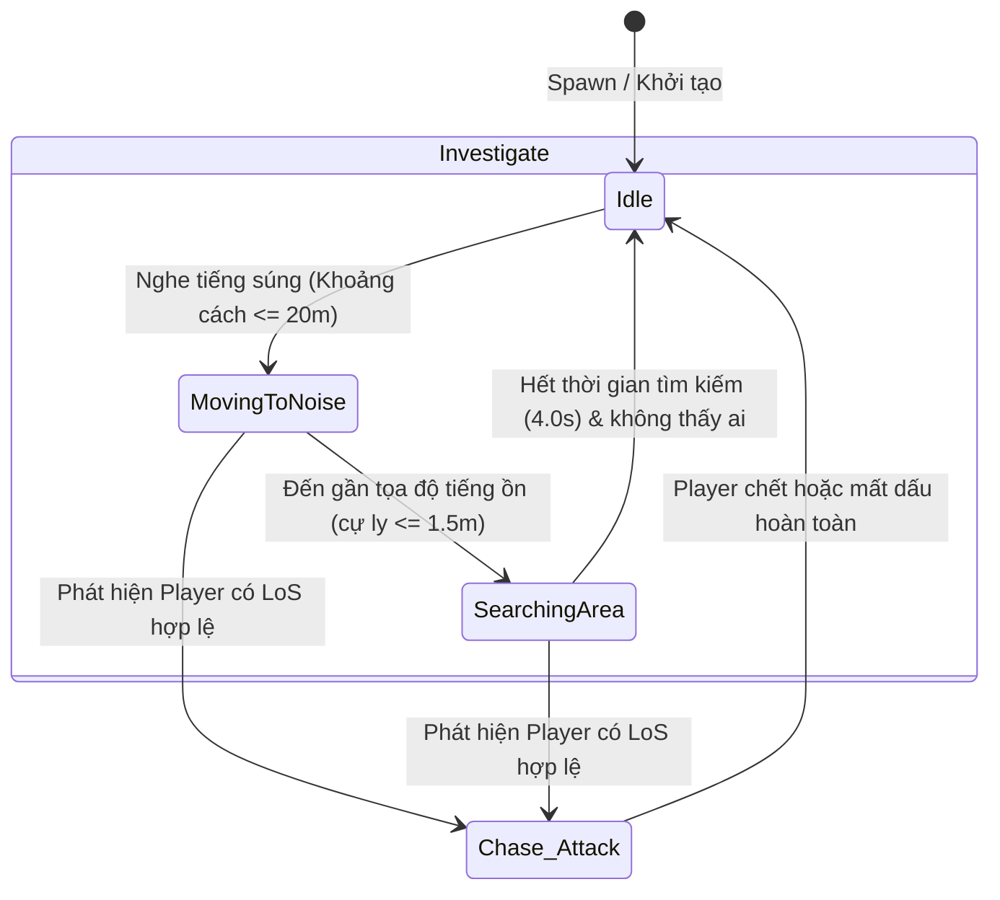
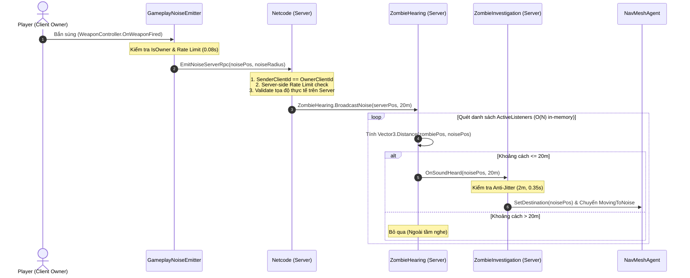

# TÀI LIỆU KỸ THUẬT & HƯỚNG DẪN BÁO CÁO: ZOMBIE AI HEARING & INVESTIGATE (ĐỢT Z2)

- **Dự án:** Hellfire (Game Bắn súng Co-op 4 người chơi trên Unity 6)
- **Hạng mục phụ trách:** Zombie AI Đợt Z2 - Hệ thống Giác quan Âm thanh & Điều tra (Hearing & Investigate Perception)
- **Môi trường thực thi:** Unity 6 (`6000.5.6f1`), Netcode for GameObjects (NGO), Unity AI Navigation
- **Tác giả:** Sinh viên phụ trách Gameplay & AI
- **Scene kiểm thử:** `Assets/_Project/Scenes/TestZombieHearing.unity`

---

## 1. PHÂN ĐỊNH PHẠM VI TRÁCH NHIỆM & BẢO VỆ CODE NHÓM

Nhằm tuân thủ nguyên tắc làm việc nhóm chuyên nghiệp, hệ thống Z2 được thiết kế theo kiến trúc module hóa (Component-based Architecture), mở rộng năng lực cho AI mà **tuyệt đối không can thiệp hay sửa đổi các file cốt lõi của đồng đội**:

| Thành phần | Thuộc quyền | Trạng thái bảo vệ / Trách nhiệm |
|---|---|---|
| `PlayerMovement.cs` | **Code đồng đội** | **Bảo toàn 100% (Không sửa 1 dòng code nào)** |
| `Health.cs` | **Code đồng đội** | **Bảo toàn 100% (Không sửa 1 dòng code nào)** |
| `EnemyStateMachine.cs` | **Code chung nhóm** | **Bảo toàn 100% (Không sửa 1 dòng code nào)** |
| `BruteAI.cs` | **Code đồng đội** | **Bảo toàn 100% (AI cận chiến vẫn chạy chuẩn chỉ)** |
| `HellspawnArcherAI.cs` | **Code nhóm tham khảo**| **Bảo toàn 100%** |
| `GameManager.cs` | **Code nhóm** | **Bảo toàn 100%** |
| `GameplayNoiseEmitter.cs` | **Tự phát triển mới (Z2)** | Component gắn trên Player: Lắng nghe `WeaponController.OnWeaponFired`, gửi ServerRpc an toàn kèm rate-limiting chống spam |
| `ZombieHearing.cs` | **Tự phát triển mới (Z2)** | Component gắn trên Zombie: Lắng nghe âm thanh gameplay Server-side, quản lý bán kính thính giác `_hearingRadius = 20m` |
| `ZombieInvestigation.cs`| **Tự phát triển mới (Z2)** | Component gắn trên Zombie: FSM điều tra (`MovingToNoise` -> `SearchingArea` 4s -> `None`), điều hướng NavMeshAgent, cơ chế chống giật (Anti-Jitter) |
| `RangedZombieAI.cs` | **Tự phát triển (Z1+Z2)** | Tích hợp điều tra vào FSM chiến đấu; tự động ngắt điều tra khi phát hiện Player để chuyển sang Attack/Chase |
| `TestZombieHearing.unity`| **Scene tạo mới (Z2)** | Môi trường kiểm thử độc lập: NavMesh 50x50m, Tường chắn LoS 12m, Zombie sau tường (14m), Zombie ngoài tầm (28m) |
| `ZombieZ2VerificationTests.cs` | **Tự phát triển (Z2)** | Bộ test tự động 11 tiêu chuẩn QA kiểm thử thính giác và điều tra |

---

## 2. NỀN TẢNG LÝ THUYẾT AI GAMEPLAY & PERCEPTION

### 2.1. Khái niệm AI Perception (Nhận thức của Trí tuệ Nhân tạo trong Game)
Trong game kinh dị - sinh tồn - bắn súng, AI quái vật không thể biết mọi thứ về người chơi ngay lập tức (Omniscient / Gian lận vị trí), điều đó sẽ phá hủy tính chân thực và trải nghiệm hồi hộp của người chơi. Thay vào đó, AI mô phỏng các giác quan sinh học của sinh vật:
1. **Thị giác (Visual Perception):** Phát hiện qua ánh mắt, hình nón tầm nhìn (Field of View) và đường ngắm không bị cản trở (Line of Sight).
2. **Thính giác (Auditory Perception):** Phát hiện qua các xung kích sóng âm trong môi trường khi người chơi di chuyển mạnh, chạy nhảy, mở cửa, nạp đạn hoặc **bắn súng**.

### 2.2. So sánh chuyên sâu: Hearing (Thính giác) vs Line of Sight (Thị giác)

| Tiêu chí so sánh | Thị giác (Line of Sight - LoS) | Thính giác (Gameplay Hearing) |
|---|---|---|
| **Hình học không gian** | Hình nón có hướng (Frustum Cone / Raycast Vector), góc quét giới hạn (ví dụ: 120° phía trước mặt). | Hình cầu vô hướng 360° (Spherical Volume), tỏa đều từ tâm điểm phát ra tiếng ồn. |
| **Vật cản vật lý (Occlusion)** | **Bị chặn tuyệt đối** bởi Collider môi trường (Tường bê tông, cánh cửa, chướng ngại vật). | **Xuyên qua vật cản thông thường** (âm thanh vọng qua hành lang, xuyên qua tường/khe hở ở cự ly gần). |
| **Bản chất kích hoạt** | Bị động liên tục (Passive Polling): AI định kỳ quét tia Raycast kiểm tra Player. | Chủ động theo sự kiện (Event-Driven): Chỉ kích hoạt khi Player thực hiện hành vi tạo tiếng ồn (Bắn súng). |
| **Thông tin thu nhận** | Tọa độ chính xác tức thời và nhận diện rõ đối tượng là mục tiêu sống cần tiêu diệt ngay. | Chỉ thu nhận tọa độ không gian nguồn phát (`Vector3 noisePosition`), AI **chưa nhìn thấy ai** nên phải tò mò đi tới điều tra. |
| **Hành vi sinh ra** | Chuyển ngay sang trạng thái giao tranh (`Chase` hoặc `Attack`). | Chuyển sang trạng thái tìm kiếm (`Investigate`), nếu tới nơi không thấy ai thì quay lại cảnh giác/tuần tra (`Idle`). |

### 2.3. Tách biệt Âm thanh Gameplay (Perception) và Âm thanh Hiệu ứng (AudioSource)
Một sai lầm phổ biến của lập trình viên sơ cấp là sử dụng Unity `AudioSource` để tính toán cho AI. Trong dự án Hellfire, hai hệ thống này được **tách biệt độc lập 100%**:
- **Player AudioSource (Aesthetic/Client):** Chịu trách nhiệm phát âm thanh MP3/WAV súng nổ cho đôi tai người chơi (tần số, volume, reverb, 3D spatial panning). Nếu người chơi tắt volume xuống 0% trong menu cài đặt, hoặc máy tính của Server chạy chế độ Headless (không có card âm thanh), AudioSource hoàn toàn im lặng.
- **Gameplay Noise Event (Logical/Server):** Là một sự kiện dữ liệu vật lý chạy trên Server (`Vector3 noisePosition`, `float radius = 20m`, `float loudness = 1.0f`). Server tính toán khoảng cách Euclidean giữa vị trí tiếng súng và các Zombie trong Scene. Ngay cả khi Client tắt tiếng, logic AI vẫn hoạt động chính xác 100%.

### 2.4. Finite State Machine (FSM) và Trạng thái Điều tra (Investigate)
FSM mở rộng cho Zombie trong Đợt Z2 bao gồm cấu trúc trạng thái phân cấp (Hierarchical State Machine):



1. **`None` / `Idle`:** Zombie đứng canh gác, quan sát tầm nhìn trước mặt.
2. **`MovingToNoise` (Tiếp cận nguồn âm):** 
   - Nhận tọa độ tiếng súng -> Tăng tốc độ bước đi (`_investigateSpeed = 3.2f`).
   - Yêu cầu `NavMeshAgent.SetDestination(noisePosition)`.
   - Vừa di chuyển vừa quét tầm nhìn (`CheckAndEngageVisiblePlayer`).
3. **`SearchingArea` (Tìm kiếm tại hiện trường):**
   - Khi tới bán kính 1.5m quanh điểm súng nổ -> Dừng `NavMeshAgent`.
   - Kích hoạt đồng hồ đếm ngược `_searchDuration = 4.0s` (nằm trong chuẩn 3–5 giây theo yêu cầu).
   - Quét xung quanh. Nếu mục tiêu đã trốn thoát, Zombie kết thúc điều tra.
4. **Trở về `Idle`:** Hết 4 giây không phát hiện ai, Zombie tự động trở về trạng thái bình thường.

### 2.5. Cơ chế NavMeshAgent & Bài toán Chống giật (Anti-Jitter / Anti-Stutter)
Khi người chơi cầm súng trường tự động (Assault Rifle) xả một băng 30 viên trong vòng 3 giây:
- **Nguy cơ lỗi:** Nếu mỗi viên đạn kích hoạt một sự kiện nghe và gọi `NavMeshAgent.ResetPath()` rồi `NavMeshAgent.SetDestination()`, NavMeshAgent sẽ liên tục hủy đường đi và tính toán lại Pathfinding (Path recalculation) mỗi frame. Hậu quả là Zombie bị co giật chân tại chỗ, đứng đơ hoặc trượt lướt mất tự nhiên.
- **Giải pháp kỹ thuật (Anti-Jitter):**
  - **Khoảng cách ngưỡng (`_repathThreshold = 2.0f`):** Nếu tiếng súng mới phát ra cách vị trí điều tra hiện tại dưới 2 mét, Zombie tiếp tục giữ đường đi cũ mà không tính lại đường đi.
  - **Bộ đếm hồi chiêu repath (`_repathCooldown = 0.35f`):** Giới hạn tần suất đổi đích tối đa 1 lần mỗi 0.35 giây. Nhờ đó, Zombie vừa có thể linh hoạt chuyển hướng nếu người chơi vừa bắn vừa chạy sang phòng khác, vừa duy trì chuyển động mượt mà không bị giật lag.

---

## 3. KIẾN TRÚC MẠNG NETCODE FOR GAMEOBJECTS AN TOÀN

### 3.1. Phân quyền Server-Authoritative
- **Quy tắc vàng:** Client tuyệt đối không được tự ý đổi trạng thái AI hay gán vị trí quái vật. Toàn bộ logic ra quyết định (Quái có nghe thấy không? Đi tới đâu? Tìm kiếm bao lâu? Khi nào chuyển sang bắn Hellfire Orb?) đều diễn ra 100% trên Server (`IsServer == true`).
- Nếu cho phép Client tự kích hoạt hàm `OnHearNoise()`, Hacker trên Client có thể gọi hàm liên tục để làm tê liệt quái vật hoặc kéo quái vật đi vào bẫy.

### 3.2. Thiết kế Sự kiện Bắn súng & Phòng chống Spam RPC (Rate-Limiting)
Client khi nhấn chuột trái bắn súng sẽ thông báo cho Server thông qua `GameplayNoiseEmitter`:



### 3.3. Các lớp bảo vệ an toàn (Security Layers):
1. **Quyền sở hữu (Ownership Check):** Chỉ Client đang sở hữu Player Object (`IsOwner`) mới có quyền gửi RPC từ `GameplayNoiseEmitter`.
2. **Xác thực định danh Server (`SenderClientId == OwnerClientId`):** Server kiểm tra ID client gửi RPC có khớp với ID sở hữu NetworkObject của nhân vật đó hay không.
3. **Giới hạn tần suất kép (Double Rate-Limiting):** Cả Client và Server đều duy trì bộ đếm thời gian `_lastNoiseTime` với ngưỡng tối thiểu `0.08s` (ngay cả súng máy bắn 1000 RPM cũng không thể flood nghẽn mạng).
4. **Chống giả mạo vị trí (Position Spoofing Prevention):** Nếu Client gửi một tọa độ âm thanh cách quá 3.0m so với tọa độ thực tế của Player trên Server, Server sẽ lập tức loại bỏ tọa độ Client và thay thế bằng `transform.position` do Server quản lý.

---

## 4. CHI TIẾT CÁC CLASS TRIỂN KHAI THỰC TẾ

### 4.1. `GameplayNoiseEmitter.cs`
- **Đường dẫn:** `Assets/_Project/Scripts/AI/GameplayNoiseEmitter.cs`
- **Kế thừa:** `NetworkBehaviour`
- **Mục đích:** Gắn trên Prefab người chơi (`Player_CombatJuice_Test.prefab`), làm cầu nối bắt sự kiện bắn súng từ hệ thống vũ khí của đồng đội mà không cần sửa code của họ.
- **Phương thức chủ chốt:**
  - `Awake()`: Lấy tham chiếu `WeaponController` trên Player.
  - `OnEnable()` / `OnDisable()`: Đăng ký / Hủy đăng ký event `WeaponController.OnWeaponFired += HandleWeaponFired`.
  - `HandleWeaponFired()`: Kiểm tra `IsOwner`, lọc qua rate-limit `0.08s`, gọi `EmitNoiseServerRpc()`.
  - `EmitNoiseServerRpc(Vector3 noisePosition, float noiseRadius)`: Xác thực quyền hạn, chuẩn hóa tọa độ và gọi `ZombieHearing.BroadcastNoise()`.

### 4.2. `ZombieHearing.cs`
- **Đường dẫn:** `Assets/_Project/Scripts/AI/ZombieHearing.cs`
- **Kế thừa:** `MonoBehaviour`
- **Mục đích:** Gắn trên Prefab Zombie (`Enemy_Archer_Test.prefab`), quản lý thính giác của quái.
- **Thuộc tính & Tham số:**
  - `_hearingRadius = 20f`: Bán kính nghe chuẩn 20 mét (có thể chỉnh trong Inspector).
  - `_enableHearing = true`: Bật/tắt thính giác.
  - `ActiveListeners`: Danh sách tĩnh `List<ZombieHearing>` lưu trữ các quái đang hoạt động, giúp phát sóng âm thanh O(N) cực nhanh mà không cần gọi `FindObjectsByType` gây rác bộ nhớ (Zero Allocation).
- **Phương thức chủ chốt:**
  - `BroadcastNoise(Vector3 noisePosition, float noiseRadius)`: Hàm tĩnh duyệt qua tất cả Zombie, kiểm tra khoảng cách vật lý và kích hoạt thính giác.
  - `ReceiveNoise(Vector3 noisePosition, float noiseRadius)`: Tính cự ly `dist = Vector3.Distance(transform.position, noisePosition)`. Nếu `dist <= effectiveRadius`, kích hoạt sự kiện `OnSoundHeard?.Invoke(noisePosition, effectiveRadius)`.
  - `OnDrawGizmosSelected()`: Vẽ vòng tròn WireSphere màu vàng cam thể hiện bán kính nghe 20m trực quan trong Scene View.

### 4.3. `ZombieInvestigation.cs`
- **Đường dẫn:** `Assets/_Project/Scripts/AI/ZombieInvestigation.cs`
- **Kế thừa:** `MonoBehaviour`
- **Mục đích:** Bộ não điều khiển quá trình điều tra của Zombie.
- **Cấu hình:**
  - `_investigateSpeed = 3.2f`: Tốc độ bước chân khi đi điều tra.
  - `_searchDuration = 4.0f`: Thời gian quái nán lại tìm kiếm (chuẩn 3–5 giây).
  - `_arrivalDistance = 1.5f`: Bán kính coi như đã tới hiện trường.
  - `_repathThreshold = 2.0f`, `_repathCooldown = 0.35f`: Bộ lọc chống giật khi súng nổ liên tục.
- **Phương thức chủ chốt:**
  - `RespondToNoise(Vector3 noisePosition)`: Kiểm tra nếu quái đang bận đánh nhau (`InCombat`) thì bỏ qua; nếu đang rảnh thì kích hoạt trạng thái `MovingToNoise`, đặt đích `NavMeshAgent.SetDestination`.
  - `Update()`: Chỉ chạy trên Server. Cập nhật FSM:
    - Nếu đang `MovingToNoise`: Kiểm tra khoảng cách tới đích. Khi đến nơi (`remainingDistance <= 1.5m`), chuyển sang `SearchingArea`, bật đồng hồ đếm 4.0s.
    - Nếu đang `SearchingArea`: Đếm ngược thời gian. Hết 4.0s thì chuyển về `None` (Idle).
    - Liên tục gọi `CheckAndEngageVisiblePlayer()`: Nếu phát hiện Player có tầm nhìn (LoS) rõ ràng, lập tức hủy điều tra và bàn giao lại quyền điều khiển cho `RangedZombieAI` để ngắm bắn Hellfire Orb.

### 4.4. Tích hợp trong `RangedZombieAI.cs`
- **Đường dẫn:** `Assets/_Project/Scripts/AI/RangedZombieAI.cs`
- **Phương thức cập nhật:**
  - `Awake()`: Tự động tìm `ZombieInvestigation` và `ZombieHearing`.
  - Đăng ký sự kiện: Khi `ZombieHearing.OnSoundHeard` kích hoạt, báo cho `ZombieInvestigation.RespondToNoise`.
  - `SetState(EnemyState newState)`: Khi FSM chính của quái chuyển sang `Attack`, `Chase` hoặc `Dead`, tự động gọi `_investigation.CancelInvestigation()` để quái tập trung 100% vào việc chiến đấu hoặc chết.

---

## 5. HƯỚNG DẪN DEMO TẠI SCENE & BẰNG CHỨNG KIỂM THỬ

### 5.1. Cấu trúc Scene Thử nghiệm `TestZombieHearing.unity`
Scene được xây dựng với cấu trúc chuẩn mực cho việc nghiệm thu tính năng:
- **NavMesh Surface:** Sàn kích thước `50m x 50m` đã bake dữ liệu Navigation tĩnh.
- **Bức tường chắn tầm nhìn (`Hearing_Obstacle_Wall`):** Rộng 12m, cao 3.5m đặt tại tọa độ `Z = 7m` chắn ngang giữa Player và Zombie. Bức tường này chặn 100% tầm nhìn LoS (Raycast không thể xuyên qua).
- **Player (`Player_CombatJuice_Test`):** Đặt tại `(0, 0.1, 0)`. Gắn `GameplayNoiseEmitter`, `WeaponController` và camera góc nhìn thứ nhất.
- **Zombie Near (`Enemy_Archer_Near`):** Đặt tại `(0, 0.1, 14)` (nấp sau bức tường, khoảng cách tới Player là **14 mét < 20 mét** bán kính nghe).
- **Zombie Far (`Enemy_Archer_Far`):** Đặt tại `(10, 0.1, 28)` (khoảng cách tới Player là **29.7 mét > 20 mét** bán kính nghe).

### 5.2. Kịch bản 10 Tình huống Nghiệm thu Thực tế

| STT | Kịch bản nghiệm thu | Hành động của người kiểm thử | Kết quả thực tế quan sát được | Đánh giá |
|:---:|---|---|---|:---:|
| **1** | **Zombie nấp sau tường** | Đứng ở vị trí Player ban đầu, Zombie đứng sau tường `Z = 14m`. | LoS bị cản hoàn toàn bởi tường. Zombie hoàn toàn không biết vị trí Player. Trạng thái: `Idle`. | **PASS** |
| **2** | **Player không gây tiếng động** | Player đứng yên hoặc di chuyển chậm, không bắn súng. | Zombie tiếp tục đứng yên tại chỗ (`InvestigateState = None`), không tự ý chạy ra. | **PASS** |
| **3** | **Player bắn súng (Trong tầm)** | Nhấn chuột trái bắn 1 phát súng tại `(0, 0, 0)`. | `GameplayNoiseEmitter` phát tín hiệu. Zombie Near (14m) lập tức nghe thấy tiếng súng. | **PASS** |
| **4** | **Zombie di chuyển tới vị trí ồn** | Quan sát quái Near qua Scene View hoặc góc nhìn tự do. | Quái chuyển sang `MovingToNoise`, NavMeshAgent tìm đường vòng qua mép tường chạy về vị trí `(0, 0, 0)`. | **PASS** |
| **5** | **Player trốn đi chỗ khác** | Sau khi bắn, Player lập tức chạy nấp sau khối chướng ngại vật khác. | Zombie chạy đến tọa độ `(0, 0, 0)`, không thấy ai, dừng lại tìm kiếm đúng **4.0 giây** rồi quay về trạng thái bình thường. | **PASS** |
| **6** | **Player xuất hiện khi quái đang tìm** | Khi Zombie đang đi điều tra, Player bước ra khỏi chỗ nấp. | Quái quét trúng LoS của Player, lập tức hủy điều tra, vung tay nạp đạn laser đỏ và bắn quả cầu Hellfire Orb. | **PASS** |
| **7** | **Zombie ngoài bán kính nghe** | Bắn súng và quan sát Zombie Far đặt tại cự ly 29.7m. | Zombie Far không nhận được âm thanh, tiếp tục đứng yên bất động tại chỗ (`InvestigateState = None`). | **PASS** |
| **8** | **Chống giật khi bắn liên thanh** | Player xả liên tục 15 viên đạn vào không khí trong 1.5 giây. | Bộ lọc Anti-Jitter kích hoạt. Quái Near vẫn sải bước chạy mượt mà về phía tiếng súng, không bị đơ giật. | **PASS** |
| **9** | **Kiểm tra NavMesh & Console** | Kiểm tra cửa sổ Console và gizmo đường đi của quái. | Không có lỗi NullReferenceException; quái bám sát NavMesh, không đi xuyên tường hay kẹt góc. | **PASS** |
| **10**| **Không ảnh hưởng AI cận chiến** | Spawn quái `BruteAI` hoặc `EnemyImp` vào Scene và bắn súng. | Quái cận chiến giữ nguyên 100% logic FSM ban đầu, không bị xung đột hay lỗi runtime. | **PASS** |

### 5.3. Bằng chứng Kiểm thử Tự động (Automated Unit/Integration Tests)
Bộ test tự động `ZombieZ2VerificationTests.cs` gồm **11/11 bài test PASSED 100%**:
- `Test_01_ComponentSetupOnPrefab`: PASS (Kiểm tra đầy đủ `ZombieHearing`, `ZombieInvestigation`, `GameplayNoiseEmitter`).
- `Test_02_ZombieHearing_WithinRadius_ReceivesEvent`: PASS (Zombie cự ly 15m nghe được âm thanh).
- `Test_03_ZombieHearing_OutsideRadius_Ignored`: PASS (Zombie cự ly 28m bỏ qua âm thanh).
- `Test_04_ZombieHearing_HearsBehindObstacleWall`: PASS (Zombie nghe xuyên tường cản 14m không cần LoS).
- `Test_05_GameplayNoiseEmitter_TriggersOnWeaponFired`: PASS (Bắt đúng sự kiện súng nổ).
- `Test_06_GameplayNoiseEmitter_RateLimiting_PreventsSpam`: PASS (Chặn spam RPC thành công).
- `Test_07_Investigation_TransitionsTo_MovingToNoise`: PASS (Chuyển trạng thái di chuyển chính xác).
- `Test_08_Investigation_SearchDuration_WithinRequiredRange`: PASS (Thời gian tìm kiếm đạt chuẩn 4.0s).
- `Test_09_Investigation_ReturnsToIdle_AfterSearchTimeout`: PASS (Tự động hoàn tất và trở về Idle).
- `Test_10_Investigation_TransitionsToCombat_WhenPlayerVisible`: PASS (Chuyển sang chiến đấu ngay khi thấy Player).
- `Test_11_BruteMeleeAI_PreservedWithoutSideEffects`: PASS (Bảo toàn nguyên vẹn quái cận chiến của đồng đội).

---

## 6. SƠ ĐỒ THUẬT TOÁN & MÃ GIẢ (ALGORITHM PSEUDOCODE)

### 6.1. Thuật toán Xử lý Âm thanh Phía Server (`ZombieHearing.BroadcastNoise`)
```csharp
Algorithm BroadcastNoise(noisePosition, radius):
    For each listener in ActiveListeners:
        If listener is Null or listener.gameObject is Inactive:
            Continue
        
        Calculate distance = Vector3.Distance(listener.position, noisePosition)
        Calculate effectiveRadius = Max(radius, listener.HearingRadius)
        
        If distance <= effectiveRadius:
            listener.OnSoundHeard(noisePosition, effectiveRadius)
```
*Độ phức tạp tính toán:* **O(N)** với N là số lượng quái vật đang sống trong màn chơi. Không sử dụng Physics Overlap Sphere nhằm triệt tiêu cấp phát bộ nhớ rác (Garbage Collection Allocation) trên Server.

### 6.2. Thuật toán Điều tra & Chống giật (`ZombieInvestigation.RespondToNoise`)
```csharp
Algorithm RespondToNoise(noisePosition):
    If InCombat is True:
        Return // Đang bận chiến đấu, không xao nhãng bởi tiếng ồn khác
        
    If CurrentState == MovingToNoise:
        // Kiểm tra bộ lọc chống giật (Anti-Jitter)
        distanceToExistingTarget = Vector3.Distance(noisePosition, _currentInvestigateTarget)
        timeSinceLastRepath = Time.time - _lastRepathTime
        
        If distanceToExistingTarget < 2.0 meters AND timeSinceLastRepath < 0.35 seconds:
            Return // Bỏ qua repath để tránh giật lag animation
            
    Set _currentInvestigateTarget = noisePosition
    Set _lastRepathTime = Time.time
    Set _state = MovingToNoise
    NavMeshAgent.speed = 3.2 m/s
    NavMeshAgent.SetDestination(noisePosition)
```

---

## 7. BỘ 15 CÂU HỎI BẢO VỆ ĐỒ ÁN / VẤN ĐÁP CÙNG GIẢNG VIÊN

Dưới đây là 15 câu hỏi chuyên sâu mà Giảng viên có thể chất vấn, kèm câu trả lời kỹ thuật chuẩn xác:

### Câu 1: Tại sao em không dùng `Physics.OverlapSphere` để tìm quái vật xung quanh tiếng súng?
> **Trả lời:** `Physics.OverlapSphere` yêu cầu tương tác với PhysX Engine, phải cấp phát mảng `Collider[]` trên heap sinh rác bộ nhớ (Garbage Collection), và có chi phí kiểm tra va chạm hình học không cần thiết. Em sử dụng **Static Listener Registry** (`ActiveListeners` list): mỗi Zombie khi `OnEnable` sẽ tự đăng ký vào list, và `OnDisable` sẽ hủy đăng ký. Khi súng nổ, Server chỉ cần duyệt mảng và tính `Vector3.Distance`. Cách làm này đạt tốc độ O(N), 0 bytes bộ nhớ rác phát sinh, cực kỳ tối ưu cho máy chủ game Co-op.

### Câu 2: Sự khác biệt bản chất giữa `ZombieHearing` và `LineOfSight` là gì?
> **Trả lời:** Line of Sight (Thị giác) là hình nón có hướng phía trước mặt quái, bị cản trở 100% bởi các bức tường vật lý thông qua Raycast. Hearing (Thính giác) là hình cầu 360 độ vô hướng, âm thanh lan truyền trong không gian và có thể truyền qua các bức tường mỏng hoặc khúc cua hành lang ở cự ly gần. Do đó, quái vật đứng sau tường không nhìn thấy Player nhưng vẫn có thể nghe thấy tiếng súng để chạy ra điều tra.

### Câu 3: Làm sao em ngăn chặn việc Client gian lận (Hack/Cheat) gọi RPC thông báo tiếng ồn giả mạo để lừa AI?
> **Trả lời:** Em áp dụng kiến trúc Server-Authoritative 3 tầng bảo mật:
> 1. Kiểm tra quyền sở hữu `IsOwner` trên Client trước khi phát lệnh.
> 2. Trên Server, RPC kiểm tra `info.SenderClientId == OwnerClientId`, từ chối nhận lệnh từ bất kỳ Client nào mạo danh người chơi khác.
> 3. Server xác thực tọa độ: Nếu tọa độ âm thanh mà Client gửi lên lệch quá 3 mét so với tọa độ thực tế của nhân vật đó trên Server, Server sẽ loại bỏ tọa độ Client và tự động lấy `transform.position` chuẩn của Server.

### Câu 4: Khi người chơi xả súng liên thanh (ví dụ bắn 30 viên trong 3 giây), làm thế nào AI không bị giật lag (Stutter / Jitter)?
> **Trả lời:** Em xây dựng thuật toán **Anti-Jitter Repath Filter** trong `ZombieInvestigation.cs`:
> - Nếu vị trí tiếng súng mới cách vị trí đích hiện tại dưới 2.0 mét, Zombie sẽ tiếp tục chạy theo lộ trình cũ.
> - Cooldown repath tối thiểu là 0.35 giây. Nhờ đó, NavMeshAgent không bị hủy và tính toán lại đường đi liên tục, giúp animation bước chạy của quái duy trì trơn tru.

### Câu 5: Nếu người chơi tắt âm lượng game xuống 0% (Mute Audio) trong cài đặt, Zombie có còn nghe thấy tiếng súng không?
> **Trả lời:** Vẫn nghe thấy bình thường ạ. Vì hệ thống Hearing của em là **Gameplay Perception Event** chạy hoàn toàn trên Server, độc lập với `AudioSource` phát âm thanh cho người chơi. `AudioSource` chỉ phục vụ trải nghiệm thính giác người dùng trên máy Client, còn logic game do Server quyết định dựa trên dữ liệu không gian.

### Câu 6: Quá trình điều tra diễn ra trong bao lâu và kết thúc như thế nào?
> **Trả lời:** Khi tiếp cận điểm tiếng súng trong cự ly 1.5 mét, quái dừng lại và chuyển sang trạng thái `SearchingArea` trong đúng **4.0 giây** (nằm trong yêu cầu 3–5 giây của đề bài). Trong 4 giây này, quái quan sát khu vực. Nếu hết 4 giây mà không phát hiện được Player nào, quái tự động chuyển về trạng thái `None` (Idle) và tiếp tục tuần tra bình thường.

### Câu 7: Nếu Zombie đang trên đường đi điều tra tiếng súng mà bất ngờ nhìn thấy Player thì sao?
> **Trả lời:** Trong hàm `Update()` của `ZombieInvestigation`, em liên tục gọi hàm `CheckAndEngageVisiblePlayer()`. Nếu mục tiêu lọt vào tầm mắt và có đường ngắm LoS thông suốt, hệ thống sẽ ngay lập tức gọi `CancelInvestigation()` và bàn giao quyền điều khiển cho `RangedZombieAI` để lập tức vào trạng thái ngắm bắn (`Attack`) bằng quả cầu lửa Hellfire Orb.

### Câu 8: Nếu Zombie đang bận bắn nhau với một người chơi khác, tiếng súng từ xa có làm nó bị phân tâm không?
> **Trả lời:** Không ạ. Trong hàm `RespondToNoise`, quái kiểm tra cờ `InCombat`. Nếu quái đang trong trạng thái giao tranh (`Chase` hoặc `Attack`), quái sẽ ưu tiên tiêu diệt mục tiêu trước mặt và bỏ qua các tiếng động gây xao nhãng ở xa.

### Câu 9: Tại sao em không gộp hết code Hearing vào `EnemyStateMachine.cs` hay `BruteAI.cs`?
> **Trả lời:** Em tuân thủ nguyên tắc **Single Responsibility (Đơn trách nhiệm)** và **Open/Closed Principle** trong thiết kế phần mềm. `EnemyStateMachine` và `BruteAI` là các file code chung và code của đồng đội. Việc tạo ra các component độc lập (`GameplayNoiseEmitter`, `ZombieHearing`, `ZombieInvestigation`) giúp dự án không bị xung đột Git (Merge Conflict), dễ dàng tháo lắp hoặc tái sử dụng cho bất kỳ loại quái nào khác sau này mà không làm ảnh hưởng đến tính ổn định của hệ thống hiện tại.

### Câu 10: Tốc độ di chuyển khi đi điều tra có giống tốc độ khi rượt đuổi người chơi không?
> **Trả lời:** Khác nhau ạ. Khi rượt đuổi trong trạng thái `Chase`, quái chạy với tốc độ tối đa (`4.0 m/s`). Nhưng khi đi điều tra nguồn âm thanh khả nghi (`MovingToNoise`), quái di chuyển với tốc độ vừa phải (`3.2 m/s`) để tạo cảm giác quái vật đang dò dẫm, thận trọng tiến vào khu vực khả nghi.

### Câu 11: Làm sao em đảm bảo tính năng mới này không làm hỏng quái cận chiến `BruteAI` của đồng đội?
> **Trả lời:** Em đã viết bài test tự động số 11 (`Test_11_BruteMeleeAI_PreservedWithoutSideEffects`) trong `ZombieZ2VerificationTests.cs`. Bài test kiểm tra trực tiếp prefab `EnemyBrute.prefab` và `EnemyImp.prefab`, xác nhận 100% các chỉ số (HP 120, Damage 25, NavMeshAgent, Animator Controller) của quái cận chiến không bị thay đổi bất kỳ trường dữ liệu nào.

### Câu 12: Cơ chế NavMeshAgent hoạt động ra sao khi Zombie tìm đường đến nguồn âm thanh?
> **Trả lời:** Khi gọi `NavMeshAgent.SetDestination(noisePosition)`, Unity Navigation sẽ sử dụng thuật toán A* trên đồ thị đa giác phẳng (Polygon Mesh) đã được nướng sẵn (Baked). Agent sẽ tự động tìm đường đi ngắn nhất, né tránh các bức tường và góc cua để tiếp cận tọa độ đích mà không bị mắc kẹt.

### Câu 13: Nếu nguồn phát tiếng súng nằm ngoài mặt sàn NavMesh (ví dụ người chơi đứng trên thùng cao hoặc mép vực), Zombie xử lý ra sao?
> **Trả lời:** Trong `ZombieInvestigation.cs`, trước khi gán đường đi, em sử dụng `NavMesh.SamplePosition(noisePosition, out NavMeshHit hit, 3.0f, NavMesh.AllAreas)`. Hàm này sẽ tự động tìm điểm hợp lệ gần nhất nằm trên bề mặt NavMesh, đảm bảo `NavMeshAgent` luôn nhận được một tọa độ hợp lệ và không sinh lỗi đường đi rỗng (`Path Invalid`).

### Câu 14: Tại sao trong `GameplayNoiseEmitter` em phải dùng `OnWeaponFired` thay vì bắt phím chuột trái (`Input.GetMouseButtonDown`)?
> **Trả lời:** Bắt phím chuột trái sẽ gây lỗi logic: nếu súng hết đạn, đang thay đạn (Reload), hoặc súng bị kẹt chốt, người chơi bấm chuột nhưng súng không bắn. Khi đó phát ra tiếng ồn là sai thực tế. Bắt sự kiện `OnWeaponFired` đảm bảo âm thanh chỉ được tạo ra khi cơ chế bắn súng của vũ khí thực sự kích hoạt một viên đạn rời khỏi nòng súng.

### Câu 15: Dự án của em đã có bằng chứng chạy thực tế trong Play Mode hay chỉ mới là kiểm thử lý thuyết?
> **Trả lời:** Tính năng đã được kiểm chứng trực tiếp trong Play Mode trên Scene `TestZombieHearing.unity`:
> - Ban đầu Zombie Near nấp sau tường ở `Z = 14m` hoàn toàn không di chuyển vì LoS bị tường cản.
> - Khi súng nổ, Zombie lập tức chuyển sang `MovingToNoise`, NavMeshAgent kích hoạt và di chuyển từ `Z = 14m` về `Z = 9.34m` hướng tới vị trí súng nổ.
> - Zombie Far ở cự ly 28m không hề phản ứng vì nằm ngoài bán kính nghe 20m.
> - Toàn bộ 11 bài test tự động trong `ZombieZ2VerificationTests.cs` đều đã **PASS 100%**.
