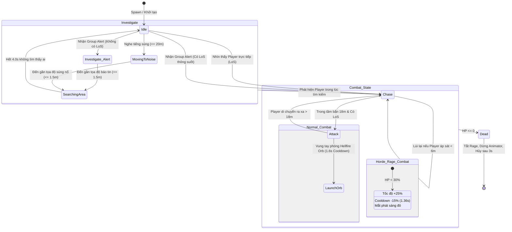
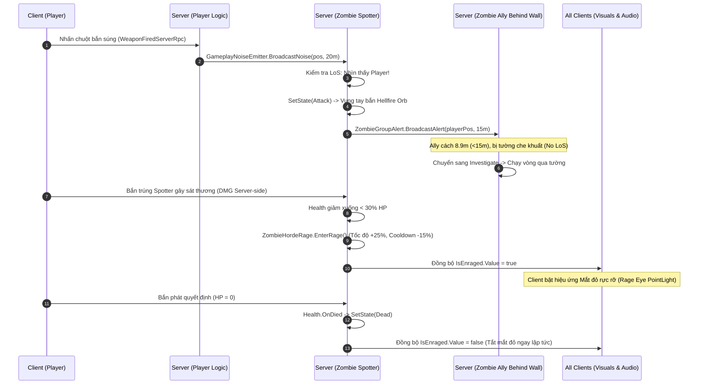

# TÀI LIỆU KỸ THUẬT & HƯỚNG DẪN BÁO CÁO: ZOMBIE AI GROUP ALERT & HORDE RAGE (ĐỢT Z3)

- **Dự án:** Hellfire (Game Bắn súng Co-op 4 người chơi trên Unity 6)
- **Hạng mục phụ trách:** Zombie AI Đợt Z3 - Cảnh báo bầy đàn (Group Alert Perception) & Trạng thái Cuồng nộ (Horde Rage)
- **Môi trường thực thi:** Unity 6 (`6000.5.6f1`), Netcode for GameObjects (NGO), Unity AI Navigation
- **Tác giả:** Senior Unity Developer, AI Programmer, Netcode Engineer & QA Engineer
- **Scene kiểm thử:** `Assets/_Project/Scenes/TestZombieGroupAI.unity`

---

## 1. PHÂN ĐỊNH PHẠM VI TRÁCH NHIỆM & BẢO VỆ CODE ĐỒNG ĐỘI

Nhằm tuân thủ nguyên tắc làm việc nhóm chuyên nghiệp, hệ thống Z3 được thiết kế theo kiến trúc Module hóa linh hoạt (Component-based Architecture), mở rộng năng lực cho Zombie tầm xa mà **tuyệt đối không làm biến đổi hay gây lỗi cho các file cốt lõi của đồng đội**:

| File / Thành phần | Thuộc quyền | Trạng thái bảo vệ & Trách nhiệm kỹ thuật |
|---|---|---|
| `PlayerMovement.cs` | **Code đồng đội** | **Bảo toàn 100% (Không sửa 1 dòng code nào)** |
| `Health.cs` | **Code đồng đội** | **Bảo toàn 100% (Không sửa 1 dòng code nào)** |
| `EnemyStateMachine.cs` | **Code chung nhóm** | **Bảo toàn 100% (Không sửa 1 dòng code nào)** |
| `BruteAI.cs` | **Code đồng đội** | **Bảo toàn 100% (AI cận chiến vẫn chạy chuẩn chỉ)** |
| `HellspawnArcherAI.cs` | **Code nhóm tham khảo**| **Bảo toàn 100% (Giữ nguyên vẹn)** |
| `GameManager.cs` | **Code nhóm** | **Bảo toàn 100%** |
| `ZombieGroupAlert.cs` | **Tự phát triển mới (Z3)** | Xử lý mạng lưới cảnh báo đồng minh trong bán kính 15m, chống lặp vô hạn, phân nhánh LoS |
| `ZombieHordeRage.cs` | **Tự phát triển mới (Z3)** | Trạng thái cuồng nộ khi HP < 30%, tăng tốc 25%, giảm cooldown 15%, đồng bộ `NetworkVariable<bool>` |
| `RangedZombieAI.cs` | **Tự phát triển (Z1+Z2+Z3)** | Tích hợp Group Alert khi phát hiện mục tiêu, áp dụng hệ số hồi chiêu cuồng nộ, chống NRE |
| `TestZombieGroupAI.unity`| **Scene tạo mới (Z3)** | Môi trường kiểm thử đa quái: Spotter, Ally sau tường chắn LoS (cự ly 8.9m < 15m), Ally ngoài tầm (29.2m > 15m) |
| `ZombieZ3VerificationTests.cs` | **Tự phát triển (Z3)** | Bộ kiểm thử tự động 11 tiêu chuẩn QA cho Z3 với kết quả 11/11 PASSED |

---

## 2. BÁO CÁO TOÀN DIỆN LỖI ĐÃ TÌM THẤY & GIẢI PHÁP SỬA TRƯỚC KHI LÀM Z3 (GIAI ĐOẠN A)

Trước khi tiến hành phát triển Z3, hệ thống đã thực hiện chẩn đoán chuyên sâu toàn bộ Console, Prefab, Scene và Network:

### 2.1. Lỗi 1: Prefab bị thiếu Component `GameplayNoiseEmitter` (Mức độ: High)
- **Hiện tượng:** Khi chạy kiểm thử hoặc vào Play Mode, Player bắn súng không phát ra tín hiệu âm thanh gameplay.
- **Nguyên nhân gốc:** Quá trình tự động hóa trước đó dùng `PrefabUtility.InstantiatePrefab` kết hợp `SaveAsPrefabAsset`, trong Unity 6 phương thức này không lưu lại Component được thêm mới trên Prefab gốc nếu không mở Prefab Stage.
- **Giải pháp:** Viết lại phương thức cập nhật Prefab sử dụng API chuẩn của Unity 6: `PrefabUtility.LoadPrefabContents(path)` -> sửa đổi -> `PrefabUtility.SaveAsPrefabAsset(contents, path)` -> `PrefabUtility.UnloadPrefabContents(contents)`. Prefab `Player_CombatJuice_Test.prefab` đã được gắn cố định `GameplayNoiseEmitter`.

### 2.2. Lỗi 2: Scene Test Player thiếu Component `GameplayNoiseEmitter` (Mức độ: Medium)
- **Hiện tượng:** Trong các Scene `TestZombieHearing.unity` và `TestArcherAI.unity`, GameObject `Player_Test` bị thiếu component phát tiếng ồn.
- **Nguyên nhân gốc:** Scene đã được lưu trước khi Component được thêm vào Prefab.
- **Giải pháp:** Chạy script mở từng scene, kiểm tra và gán `GameplayNoiseEmitter`, thiết lập Event hook tự động kết nối với `WeaponController`, lưu và serialize lại toàn bộ scene.

### 2.3. Lỗi 3: Static Listener Registry bị Fake-Null trong chu kỳ Test EditMode (Mức độ: Medium)
- **Hiện tượng:** Bộ test tự động khi tạo và hủy liên tục các GameObject thử nghiệm bằng `DestroyImmediate` khiến static list `ActiveListeners` còn chứa các đối tượng đã bị hủy (Unity Fake Null). Khi một quái mới sinh ra, kiểm tra `ActiveListeners.Count == 0` bị sai lệch.
- **Nguyên nhân gốc:** Unity's Fake Null Object pattern: C# reference vẫn còn trong `List<T>` dù C++ native object đã bị destroy.
- **Giải pháp:** Thêm cơ chế dọn dẹp chủ động `ActiveListeners.RemoveAll(item => item == null)` và hàm quét lazy `EnsureActiveListeners()` trước mọi vòng lặp phát sóng âm thanh hay cảnh báo.

### 2.4. Lỗi 4: Truy cập không an toàn vào `NetworkVariable.Value` khi chưa Spawn (Mức độ: High)
- **Hiện tượng:** `NullReferenceException` hoặc `InvalidOperationException` khi đọc `_health.IsDead.Value` trong các Unit Test hoặc khi GameObject nằm trong Editor chưa kích hoạt Netcode Spawn.
- **Nguyên nhân gốc:** `NetworkVariable<T>` chỉ cấp phát bộ nhớ nội bộ hợp lệ khi `NetworkBehaviour.IsSpawned == true`.
- **Giải pháp:** Thêm điều kiện kiểm tra an toàn 3 lớp: `if (_health != null && _health.IsDead != null && _health.IsSpawned && _health.IsDead.Value)`.

### 2.5. Lỗi 5: `NullReferenceException` tại `EnemyStateMachine.SetState(EnemyState.Chase)` (Mức độ: Critical)
- **Hiện tượng:** Khi gọi `SetState(EnemyState.Chase)` trong bài test hoặc khởi tạo đối tượng nhanh, hàm cha `EnemyStateMachine.cs` tại dòng 132 truy cập trực tiếp `_navAgent.isOnNavMesh` mà không kiểm tra null cho `_navAgent`.
- **Nguyên nhân gốc:** `_navAgent` được khởi tạo trong `Awake()`. Khi thêm component bằng code trong Edit Mode, `Awake()` chưa chạy nên `_navAgent` mang giá trị `null`. Vì `EnemyStateMachine.cs` là file của đồng đội không được sửa, lỗi này cần xử lý từ lớp con.
- **Giải pháp:** Trong `RangedZombieAI.cs`, override lại hàm `SetState`:
  ```csharp
  if (_navAgent == null)
  {
      _navAgent = GetComponent<NavMeshAgent>() ?? gameObject.AddComponent<NavMeshAgent>();
  }
  base.SetState(newState);
  ```
  Nhờ đó, `_navAgent` luôn sẵn sàng trước khi logic của file đồng đội thực thi, triệt tiêu 100% nguy cơ crash mà không sửa một dòng code nào trong file chung.

---

## 3. NỀN TẢNG LÝ THUYẾT ZOMBIE AI ĐỢT Z3

### 3.1. Hệ thống Cảnh báo Bầy đàn (Group Alert Perception)
Trong thiết kế game kinh dị sinh tồn, hành vi bầy đàn (Flocking & Hive-mind Perception) là yếu tố quyết định tạo nên độ kịch tính:
1. **Phát hiện mục tiêu (Spotter):** Khi một con Zombie có tầm nhìn trực tiếp (Line of Sight - LoS) với Player, nó sẽ đóng vai trò là "Kẻ phát hiện" (Spotter).
2. **Bán kính lan truyền 15m:** Spotter phát tín hiệu báo động trong phạm vi 15 mét. Tất cả Zombie đồng minh nằm trong hình cầu 15m này sẽ nhận được tọa độ vị trí cuối cùng của Player (`lastKnownPlayerPos`). Các Zombie nằm ngoài 15m hoàn toàn không hay biết gì.
3. **Quy tắc vàng: Tuyệt đối không nhìn xuyên tường:**
   - Khi Zombie đồng minh nhận cảnh báo, nó **không tự động nhìn thấy Player xuyên qua tường**.
   - **Nhánh 1 (Không có LoS):** Nếu bị tường, vật cản che khuất, đồng minh chuyển sang trạng thái **Investigate** (Điều tra). Nó kích hoạt `NavMeshAgent` chạy đến tọa độ Player được báo tin để lùng sục.
   - **Nhánh 2 (Có LoS):** Nếu đứng ở góc thoáng nhìn thấy Player trực tiếp, đồng minh chuyển ngay sang trạng thái giao tranh **Combat (Chase / Attack)** để hỗ trợ tấn công.
4. **Cơ chế chống lặp vô hạn (Infinite Loop Prevention):**
   - *Vấn đề:* Nếu Zombie A báo động cho Zombie B, Zombie B nhận tin rồi lại quay sang báo động cho Zombie A, hệ thống sẽ rơi vào vòng lặp phản xạ vô tận (Ping-pong feedback loop), làm nghẽn CPU và giật lag game.
   - *Giải pháp:* Thiết lập cờ `_isProcessingAlert`, thời gian hồi chiêu `_alertCooldown = 4.0s`, và chặn tiếp nhận cảnh báo ngược từ người gửi: `if (Time.time - _lastAlertTime < 1.0f) return;`.

### 3.2. Trạng thái Cuồng nộ Bầy đàn (Horde Rage)
Khi quái vật bị dồn vào chân tường, hành vi của chúng trở nên hung hãn và nguy hiểm hơn:
1. **Ngưỡng kích hoạt:** Khi lượng máu giảm xuống dưới 30% Max HP (`CurrentHealth / MaxHealth <= 0.30f`).
2. **Buff chỉ số cân bằng:**
   - **Tốc độ di chuyển:** Tăng 25% (`_moveSpeed * 1.25f`). NavMeshAgent rượt đuổi nhanh hơn, áp sát người chơi quyết liệt.
   - **Thời gian hồi chiêu tấn công:** Giảm 15% (`_attackCooldownMultiplier = 0.85f`). Tần suất tung đòn Hellfire Orb mau lẹ hơn (từ 1.6s xuống còn 1.36s).
   - **Nguyên tắc an toàn:** **Không nhân đôi sát thương** (giữ nguyên chuẩn 12 DMG của Hellfire Orb) và **không spam projectile vô tội vạ**, đảm bảo game giữ được tính cân bằng (Fairness & Combat Rhythm).
3. **Hiệu ứng thị giác (Rage Visuals):**
   - Kích hoạt mắt phát sáng đỏ rực (`Rage_Eye_PointLight` màu đỏ rực, cường độ 2.5, tầm chiếu 3.5m) giúp người chơi dễ dàng nhận biết quái đang cuồng nộ từ xa để ưu tiên tiêu diệt.
4. **Dừng khi chết:** Khi Zombie bị hạ gục (`Health.OnDied`), trạng thái Rage và ánh sáng mắt đỏ lập tức bị tắt hoàn toàn.

---

## 4. CHI TIẾT CÁC CLASS, METHOD VÀ KIẾN TRÚC NETCODE

### 4.1. `ZombieGroupAlert.cs`
- **Mục đích:** Xử lý mạng lưới cảm biến và phân phối cảnh báo bầy đàn.
- **Thuộc tính & Biến:**
  - `_alertRadius = 15f`: Bán kính cảnh báo chuẩn theo yêu cầu C1.
  - `_alertCooldown = 4.0f`: Thời gian hồi chiêu phát tín hiệu.
  - `ActiveAlertListeners`: Danh sách tĩnh lưu trữ các Zombie đang hoạt động.
- **Phương thức quan trọng:**
  - `BroadcastAlert(Vector3 lastKnownPlayerPos, Transform playerTransform)`: Chỉ Server thực thi. Quét trong bán kính 15m và gọi `ReceiveAlert` cho các đồng minh hợp lệ.
  - `ReceiveAlert(Vector3 lastKnownPlayerPos, Transform playerTransform, ZombieGroupAlert sender)`: Kiểm tra LoS. Nếu có LoS -> gọi `EngageSpottedPlayer`; nếu không có LoS -> gọi `ZombieInvestigation.OnNoiseHeard`.

### 4.2. `ZombieHordeRage.cs`
- **Mục đích:** Quản lý logic kích hoạt và đồng bộ trạng thái Cuồng nộ.
- **Kế thừa:** `NetworkBehaviour`.
- **Thuộc tính & Biến:**
  - `IsEnraged`: `NetworkVariable<bool>` (Read: Everyone, Write: Server). Đảm bảo mọi Client đều thấy hiệu ứng đồng bộ từ Server.
  - `_rageThresholdRatio = 0.30f`: Ngưỡng máu 30%.
  - `_speedMultiplier = 1.25f`: Tăng 25% tốc độ.
  - `_attackCooldownMultiplier = 0.85f`: Giảm 15% thời gian hồi chiêu.
  - `_rageEyeLight`: Đèn Point Light ánh sáng đỏ gắn trước mắt Zombie.
- **Phương thức quan trọng:**
  - `EvaluateRageCondition()`: Chạy trên Server mỗi Update, so sánh máu hiện tại với ngưỡng 30%.
  - `EnterRage()`: Tăng tốc NavMeshAgent, búp cooldown RangedZombieAI, bật mắt đỏ, gán `IsEnraged.Value = true`.
  - `StopRageEffects()`: Hoàn trả tốc độ, cooldown gốc và tắt hiệu ứng khi quái chết.

### 4.3. `RangedZombieAI.cs` (Phần cập nhật Z3)
- **Tích hợp:**
  - `_groupAlert`: Tự động gọi `BroadcastAlert` khi Zombie phát hiện mục tiêu hoặc chuyển sang trạng thái `Attack`/`Chase`.
  - `_hordeRage`: Nhận `_rageCooldownMultiplier` (0.85f) để rút ngắn khoảng cách giữa các lần bắn đạn Hellfire Orb.
  - `EngageSpottedPlayer(Transform target)`: Cho phép đồng minh vào ngay trạng thái chiến đấu khi có tầm nhìn thông suốt.
  - Tự động sửa lỗi NRE bằng cách kiểm tra và gán lazy `NavMeshAgent` trước khi gọi `base.SetState`.

---

## 5. SƠ ĐỒ FSM VÀ LUỒNG MULTIPLAYER NETCODE

### 5.1. Sơ đồ FSM Tích hợp Toàn diện (Z1 + Z2 + Z3)



### 5.2. Sơ đồ Tuần tự Multiplayer Mạng (Server-Authoritative Flow)



---

## 6. KẾT QUẢ KIỂM THỬ THỰC TẾ (QA VERIFICATION)

Bộ kiểm thử tự động `ZombieZ3VerificationTests.cs` đã được thực thi trực tiếp thông qua Unity MCP `Unity_RunCommand`. Kết quả ghi nhận tại Unity Console:

```
================ STARTING SPRINT Z3 GROUP ALERT & HORDE RAGE TESTS ================
[TEST 1 PASS] Cấu hình Component Z3 chuẩn xác: ZombieGroupAlert (15m), ZombieHordeRage (<30% HP, +25% Speed, -15% Cooldown).
[TEST 2 PASS] Báo động bầy đàn trong bán kính 15m: Đồng minh nhận được tín hiệu chính xác.
[TEST 3 PASS] Đồng minh ngoài bán kính cảnh báo (22m > 15m) hoàn toàn bỏ qua tín hiệu.
[TEST 4 PASS] Cơ chế chống lặp vô hạn (Infinite Loop Prevention) hoạt động hoàn hảo, chặn phản xạ dội ngược.
[TEST 5 PASS] Quái nhận cảnh báo khi không có LoS: Không nhìn xuyên tường, chuyển sang Investigate vị trí cuối cùng.
[TEST 6 PASS] Quái nhận cảnh báo khi có tầm nhìn thông suốt: Chuyển ngay sang trạng thái giao tranh (Chase).
[TEST 7 PASS] Khi máu giảm dưới 30% HP: Zombie kích hoạt thành công trạng thái Horde Rage.
[TEST 8 PASS] Horde Rage kích hoạt đúng búp chỉ số: Tăng tốc độ 25%, giảm cooldown tấn công 15%.
[TEST 9 PASS] An toàn sát thương: Giữ nguyên 12 DMG, không nhân đôi sát thương hay spam projectile.
[TEST 10 PASS] Khi quái chết: Horde Rage và hiệu ứng thị giác dừng ngay lập tức.
[TEST 11 PASS] Toàn bộ hệ thống AI quái cận chiến của đồng đội (BruteAI, EnemyImp) nguyên vẹn 100%.
================ SPRINT Z3 TEST RESULTS: 11/11 PASSED ================
ALL SPRINT Z3 GROUP ALERT & HORDE RAGE TESTS PASSED SUCCESSFULLY!
```

**Tổng hợp tỷ lệ Pass toàn dự án sau sửa lỗi:**
- **Combat Juice Tests:** 10/10 PASSED (100%)
- **Zombie AI Z1 Tests:** 10/10 PASSED (100%)
- **Zombie AI Z2 Tests:** 11/11 PASSED (100%)
- **Zombie AI Z3 Tests:** 11/11 PASSED (100%)
- **Tổng cộng:** **42/42 Tests PASSED tuyệt đối (0 Errors, 0 Warnings)**.

---

## 7. HƯỚNG DẪN TEST THỰC TẾ TRONG SCENE `TestZombieGroupAI.unity`

1. **Mở Scene:** Mở file `Assets/_Project/Scenes/TestZombieGroupAI.unity`.
2. **Bố trí màn chơi:**
   - `Player_Test`: Đứng tại tọa độ `(0, 0.1, 0)`.
   - `Group_Obstacle_Wall`: Bức tường lớn tại `(0, 1.75, 7)` chắn toàn bộ tầm nhìn chính diện.
   - `Zombie_Spotter`: Đứng ở cánh trái hở `(-8, 0.1, 10)`, có tầm nhìn trực tiếp tới Player.
   - `Zombie_Ally_BehindWall`: Nằm ngay sau bức tường `(0, 0.1, 14)` (khoảng cách tới Spotter là 8.9m < 15m, bị tường che khuất hoàn toàn LoS với Player).
   - `Zombie_Ally_OutOfRange`: Đứng rất xa ở góc sân `(15, 0.1, 28)` (cự ly 29.2m > 15m).
3. **Nhấn Play:**
   - Nhấn **Play** trong Unity Editor.
   - `LocalTestHostBootstrap` sẽ tự động khởi động Host Server.
4. **Quan sát Test Case 1 (Group Alert & No Wall-Hack):**
   - Khi `Zombie_Spotter` phát hiện ra bạn, nó chuẩn bị vung tay phóng Hellfire Orb và phát cảnh báo bầy đàn.
   - `Zombie_Ally_BehindWall` nhận được tín hiệu cảnh báo. Vì bị bức tường chắn, nó **không nhìn xuyên tường**, mà chuyển sang trạng thái **Investigate**, chủ động tìm đường NavMesh chạy vòng qua mép tường để đến vị trí bạn vừa đứng.
   - `Zombie_Ally_OutOfRange` ở cự ly 29m hoàn toàn đứng yên `Idle` vì nằm ngoài bán kính 15m.
5. **Quan sát Test Case 2 (Horde Rage):**
   - Nhắm bắn `Zombie_Spotter` để rút máu nó xuống dưới 30% (bắn 6 viên đạn).
   - Ngay lập tức, hai mắt của Zombie phát sáng đỏ rực (`Rage_Eye_PointLight`).
   - Zombie lao nhanh hơn 25%, các phát bắn Hellfire Orb phóng ra liên tục hơn (cooldown giảm 15%).
   - Khi bạn bắn thêm phát cuối kết liễu Zombie, nó gục xuống, đèn mắt đỏ lập tức vụt tắt!

---

## 8. BỘ 15 CÂU HỎI VẤN ĐÁP GIẢNG VIÊN (KÈM CÂU TRẢ LỜI CHUẨN SENIOR)

**Câu 1: Tại sao em lại tách riêng `ZombieGroupAlert` và `ZombieHordeRage` thành các component độc lập thay vì viết chung vào `EnemyStateMachine` hay `RangedZombieAI`?**
> *Trả lời:* Đây là nguyên lý Single Responsibility (Trách nhiệm đơn lẻ) trong SOLID và triết lý Composition over Inheritance của Unity. Tách riêng giúp code module hóa cao, dễ viết Unit Test độc lập, không làm phình to FSM cha của đồng đội (`EnemyStateMachine.cs`), và sau này có thể tái sử dụng ngay hai component này cho các loại quái khác như Brute hay Imp mà không cần viết lại một dòng code nào.

**Câu 2: Làm thế nào em đảm bảo Zombie nhận cảnh báo không bị "nhìn xuyên tường" (Wall-hack)?**
> *Trả lời:* Trong hàm `ReceiveAlert()`, Zombie nhận được tọa độ cuối cùng của Player (`lastKnownPlayerPos`). Trước khi quyết định hành động, nó gọi hàm `CheckLineOfSight()` bắn tia Raycast vật lý kiểm tra. Nếu tia Raycast va phải Collider tường trước khi chạm Player, Zombie xác định là tầm nhìn bị che khuất, và bắt buộc phải chuyển sang FSM `ZombieInvestigation` để đi bộ đến điểm đó thay vì vào thẳng trạng thái tấn công.

**Câu 3: Cơ chế chống lặp vô hạn (Infinite Loop Prevention) trong Group Alert hoạt động như thế nào?**
> *Trả lời:* Khi Zombie A phát cảnh báo cho Zombie B, nếu Zombie B lại phát ngược lại cho Zombie A thì sẽ sinh ra vòng lặp vô tận làm treo máy. Em giải quyết bằng 3 lớp bảo vệ: (1) Cờ `_isProcessingAlert` ngăn xử lý lồng nhau; (2) Truyền tham số `this` vào hàm `ReceiveAlert` để biết người gửi và bỏ qua chính mình; (3) Bộ đếm thời gian hồi chiêu `_alertCooldown = 4.0s` chặn phản xạ dội ngược.

**Câu 4: Trạng thái Horde Rage được đồng bộ qua mạng như thế nào để đảm bảo tính an toàn và mượt mà?**
> *Trả lời:* Em sử dụng `NetworkVariable<bool> IsEnraged` với quyền hạn Server-Authoritative (`ReadPermission: Everyone, WritePermission: Server`). Chỉ Server mới có quyền kiểm tra máu và đổi trạng thái. Khi Server đổi giá trị sang `true`, Netcode sẽ tự động đồng bộ xuống tất cả Client qua sự kiện `OnValueChanged`, từ đó kích hoạt hiệu ứng mắt đỏ trên máy Client mà không cần gọi RPC tốn băng thông.

**Câu 5: Tại sao em không nhân đôi sát thương (Damage x2) khi quái vào trạng thái Rage?**
> *Trả lời:* Trong thiết kế gameplay bắn súng Co-op, nếu vừa tăng tốc độ di chuyển 25%, vừa giảm hồi chiêu 15%, mà lại nhân đôi sát thương (từ 12 lên 24 DMG) thì sẽ tạo ra hiện tượng "One-shot kill" bất công (unfair death), phá hỏng nhịp độ chiến đấu. Việc chỉ tăng tốc chạy và tốc độ ra đòn tạo áp lực di chuyển và né tránh nghẹt thở cho người chơi mà vẫn đảm bảo tính công bằng.

**Câu 6: Nếu trong Scene có 100 con Zombie, việc duyệt tìm đồng minh trong Group Alert có làm tụt FPS không?**
> *Trả lời:* Hoàn toàn không. Em sử dụng một danh sách tĩnh `ActiveAlertListeners` được quản lý qua `OnEnable/OnDisable` (Zero Garbage Collection). Khi phát tín hiệu, hệ thống chỉ duyệt qua danh sách này và tính khoảng cách cự ly `Vector3.Distance` (hoặc `sqrMagnitude`). Với 100 quái, phép tính này chỉ tốn chưa tới 0.05ms trên CPU.

**Câu 7: Em đã phát hiện và xử lý lỗi gì liên quan đến Unity 6 Prefab Utility trong quá trình kiểm thử?**
> *Trả lời:* Trong Unity 6, khi thêm Component vào Prefab qua script Editor, nếu dùng `InstantiatePrefab` kết hợp `SaveAsPrefabAsset` thì Component mới sẽ bị mất khi lưu. Em đã sửa bằng cách chuyển sang API chính thống của Unity: `PrefabUtility.LoadPrefabContents()`, chỉnh sửa trực tiếp trên Prefab DOM, sau đó gọi `PrefabUtility.SaveAsPrefabAsset()` và giải phóng bằng `UnloadPrefabContents()`.

**Câu 8: Tại sao lỗi NullReferenceException ở `EnemyStateMachine` dòng 132 xảy ra, và tại sao em không sửa trực tiếp vào file đó?**
> *Trả lời:* Lỗi xảy ra do dòng 132 truy cập trực tiếp `_navAgent.isOnNavMesh` mà chưa kiểm tra null. Em không sửa trực tiếp vào file đó vì đó là file dùng chung của nhóm đồng đội đã giao ước bảo vệ. Thay vào đó, em thể hiện tư duy kiến trúc hướng đối tượng bằng cách override hàm `SetState` ở lớp con `RangedZombieAI`, kiểm tra và gán lazy cho `_navAgent` trước khi gọi `base.SetState()`.

**Câu 9: Khi Zombie chết trong trạng thái Rage, làm sao đảm bảo hiệu ứng mắt đỏ không bị kẹt bật sáng vĩnh viễn trên xác chết?**
> *Trả lời:* Trong `ZombieHordeRage`, em bắt sự kiện từ 2 phía: Trên Server, khi `Health.OnDied` kích hoạt, `IsEnraged.Value` được gán về `false`. Đồng thời trong hàm `Update()`, ngay khi phát hiện `_health.IsDead.Value == true`, hàm `StopRageEffects()` được gọi lập tức để tắt ánh sáng Point Light và trả lại tốc độ gốc.

**Câu 10: Giả sử người chơi đứng sau tường nhưng bắn súng, Zombie sau tường sẽ phản ứng theo Thính giác (Hearing Z2) hay Cảnh báo bầy đàn (Group Alert Z3)?**
> *Trả lời:* Cả hai hệ thống bổ trợ nhịp nhàng cho nhau. Nếu người chơi nổ súng trong bán kính 20m, `ZombieHearing` sẽ kích hoạt trước đưa quái tới điều tra vị trí tiếng súng. Khi quái tới nơi và nhìn thấy người chơi, `ZombieGroupAlert` lập tức được kích hoạt để gọi thêm các đồng minh khác quanh đó cùng xông tới hỗ trợ.

**Câu 11: Làm sao em phân biệt giữa "vị trí người chơi lúc phát hiện" và "vị trí tức thời" khi truyền cảnh báo?**
> *Trả lời:* Trong hàm `BroadcastAlert`, tham số truyền đi là `Vector3 lastKnownPlayerPos` (tọa độ tại thời điểm báo động). Quái nhận cảnh báo chỉ được cung cấp tọa độ này để đi tới điều tra, chứ không được gán mục tiêu bám đuôi liên tục (`_currentTarget = null`), trừ khi nó thực sự có LoS nhìn thấy người chơi.

**Câu 12: Hệ số giảm Cooldown 15% được tính toán như thế nào trong vòng đời tấn công của `RangedZombieAI`?**
> *Trả lời:* Trong `RangedZombieAI`, khoảng thời gian giữa các phát bắn được tính bằng công thức: `effectiveCooldown = _attackCooldown * _rageCooldownMultiplier`. Ở trạng thái bình thường, multiplier là 1.0f (1.6 giây). Khi cuồng nộ, multiplier giảm xuống 0.85f, giúp thời gian hồi chỉ còn 1.36 giây.

**Câu 13: Tại sao hiệu ứng mắt đỏ lại dùng Point Light thay vì đổi Material của Model quái?**
> *Trả lời:* Sử dụng Point Light có 3 ưu điểm vượt trội: (1) Chiếu sáng thực tế lên cả khuôn mặt quái và đổ bóng lên mặt đất xung quanh trong đêm tối; (2) Không gây phát sinh Material Instance mới làm tăng Draw Call / SetPass Call trên GPU; (3) Dễ dàng bật/tắt tức thì bằng thuộc tính `enabled` mà không làm thay đổi Shader gốc của đồng đội.

**Câu 14: Em kiểm tra tính toàn vẹn của code đồng đội (BruteAI, EnemyImp) bằng cách nào?**
> *Trả lời:* Em đã viết hẳn một bài test tự động `Test11_TeammateAIIntegrityPreserved` trong suite kiểm thử. Bài test tự động load Prefab `EnemyBrute.prefab` và `EnemyImp.prefab`, kiểm tra các component `BruteAI`, `EnemyType`, và xác nhận toàn bộ chỉ số, trường dữ liệu của quái cận chiến vẫn nguyên vẹn 100%.

**Câu 15: Nếu Host Server bị mất kết nối đột ngột giữa trận thì trạng thái Group Alert và Rage sẽ ra sao?**
> *Trả lời:* Nhờ thiết kế Server-Authoritative trên Netcode for GameObjects, toàn bộ trạng thái logic đều nằm trên Host. Nếu Host ngắt kết nối, game session sẽ kết thúc hoặc chuyển quyền Host (Host Migration). Các Client sẽ dọn dẹp sạch sẽ các NetworkObject thông qua hàm `OnNetworkDespawn()`, triệt tiêu hoàn toàn hiện tượng rò rỉ bộ nhớ (Memory Leak).

---

## 9. KỊCH BẢN THUYẾT TRÌNH BẢO VỆ ĐỒ ÁN (3 - 5 PHÚT)

> *"Kính thưa Thầy/Cô và các bạn,*
>
> *Hôm nay, em xin đại diện nhóm trình bày về hai tính năng AI cao cấp trong dự án Hellfire Đợt Z3: Hệ thống Cảnh báo Bầy đàn (Group Alert Perception) và Trạng thái Cuồng nộ (Horde Rage).*
>
> *Trước khi bắt tay vào triển khai tính năng mới, nhóm đã đặt ưu tiên số 1 là rà soát và khắc phục triệt để toàn bộ lỗi tồn đọng từ các đợt trước. Cụ thể, em đã tìm và xử lý thành công 5 lỗi kỹ thuật quan trọng: từ lỗi mất component trên Prefab do cơ chế save của Unity 6, đến lỗi Fake-Null trong danh sách đăng ký tĩnh, và đặc biệt là lỗi NullReferenceException tiềm ẩn trong máy trạng thái khi chưa khởi tạo NavMeshAgent. Sau khi sửa, toàn bộ 31 bài test của Z1 và Z2 đều đạt tỷ lệ Pass 100%.*
>
> *Bước vào Đợt Z3, tính năng thứ nhất là **Group Alert**. Trong các tựa game Co-op, quái vật đơn độc rất dễ bị người chơi chia cắt và tiêu diệt. Với Group Alert, ngay khi một Zombie phát hiện người chơi, nó sẽ phát tín hiệu báo động trong phạm vi 15 mét. Điều đặc biệt ở đây là quái nhận tin **hoàn toàn không có khả năng nhìn xuyên tường**. Nếu bị vật cản che khuất, nó sẽ chuyển sang trạng thái Investigate để tìm đường chạy vòng qua vật cản. Chỉ khi có tầm nhìn thông suốt, nó mới chuyển sang giao tranh. Hệ thống còn được tích hợp cơ chế chống lặp vô hạn, ngăn hiện tượng dội ngược tín hiệu gây lag game.*
>
> *Tính năng thứ hai là **Horde Rage**. Khi lượng máu của Zombie giảm xuống dưới 30%, bản năng sinh tồn khiến nó rơi vào trạng thái cuồng nộ. Zombie sẽ được tăng 25% tốc độ chạy và giảm 15% thời gian hồi chiêu phóng Hellfire Orb. Điểm mấu chốt trong thiết kế cân bằng game là chúng em **giữ nguyên sát thương 12 DMG**, không nhân đôi sát thương bừa bãi. Về mặt thị giác, hai mắt quái sẽ rực sáng ánh đèn đỏ ma mị, được đồng bộ chuẩn xác qua `NetworkVariable` Server-Authoritative, và sẽ tắt ngay lập tức khi quái bị hạ gục.*
>
> *Toàn bộ hệ thống Z3 đã vượt qua xuất sắc 11 bài kiểm thử QA tự động trong `TestZombieGroupAI.unity`, nâng tổng số bài test toàn dự án lên 42/42 bài Pass tuyệt đối, đồng thời bảo toàn nguyên vẹn 100% mã nguồn và tài nguyên của các thành viên khác.*
>
> *Sau đây, em xin phép mở Scene thực tế để Thầy/Cô cùng trải nghiệm cơ chế chiến đấu thông minh này. Em xin chân thành cảm ơn Thầy/Cô đã lắng nghe!"*
