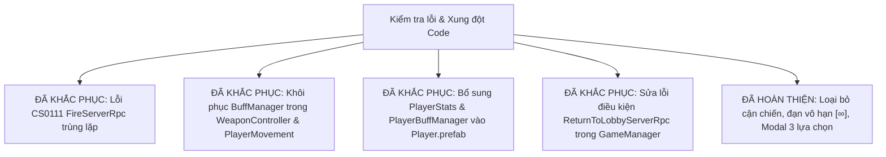

# BÁO CÁO PHÂN TÍCH KIẾN TRÚC & TÁC ĐỘNG HỆ THỐNG (HELLFIRE)
*(Cập nhật toàn diện: Tích hợp Hệ thống Chiến đấu Súng Hoàn toàn, Đạn Vô Hạn, Nâng cấp Toàn cục Giữ nguyên Khi Đổi Vũ Khí, Modal 3 Lựa Chọn Tế Đàn / Modifier & Khắc phục Toàn bộ Xung đột Code)*

---

## 1. Sơ Đồ Khối Kiến Trúc & Luồng Dữ Liệu Tổng Quan

### 1.1. Tóm tắt Architecture Patterns Đang Sử Dụng
Dự án **Hellfire** là một game bắn súng góc nhìn thứ nhất (FPS) Co-op qua mạng LAN (tối đa 4 người) được xây dựng trên nền tảng **Unity 6 (`6000.5.6f1`)**, **Unity Netcode for GameObjects (NGO `2.13.2`)**, **Unity Transport (UTP `2.6.0`)** kết hợp **AI Navigation (`2.0.14`)**. Codebase triển khai các design pattern cốt lõi:

1. **Server-Authoritative Network Pattern**:
   * Mọi quyết định trạng thái then chốt (trừ máu, tính toán giáp hiệu dụng theo hàm mũ $e^{-0.01053605 \times \text{Armor}}$, nâng cấp chỉ số, kiểm tra điều kiện tế đàn, mở rương nhặt đồ, đếm ngược thời gian bùa lợi, FSM của AI, sinh bản đồ ngục) đều do Server/Host làm chủ tuyệt đối.
   * Client chỉ gửi dữ liệu đầu vào qua RPC (`ServerRpc`) và nhận dữ liệu đồng bộ trạng thái qua `NetworkVariable` hoặc `ClientRpc` để hiển thị visual/âm thanh.
2. **Phân tách Trách nhiệm Chỉ số Đa Tầng (Decoupled Stat Architecture)**:
   * **Chỉ số Thân thể (`PlayerStats`)**: Quản lý các chỉ số sinh tồn và cơ động nội tại: Máu cộng thêm (`BonusMaxHealth`), Giáp (`Armor`), Hệ số tốc chạy (`MoveSpeedMultiplier`) với các trần cứng bảo vệ (Max Caps). Không sở hữu chỉ số tấn công.
   * **Chỉ số Vũ khí Toàn cục (`WeaponController` Global Stats)**: Quản lý toàn bộ nâng cấp hỏa lực có tính chất kế thừa: Sát thương (`GlobalDamageMultiplierNet`), Tốc bắn (`GlobalAttackSpeedMultiplierNet`), Xuyên giáp (`GlobalArmorPenetrationNet`), Tỉ lệ bạo kích (`GlobalCritChanceBonusNet`), Sát thương bạo kích (`GlobalCritMultiplierBonusNet`). **Khi người chơi nhặt súng mới hoặc đổi súng, toàn bộ các nâng cấp này đều được bảo toàn**.
   * **Bùa lợi Tạm thời / Lượt chơi (`PlayerBuffManager`)**: Quản lý các hiệu ứng gia tăng động nhặt được từ rương: Giày tốc độ (`SpeedMultiplierNet`), Bùa cuồng nộ (`DamageMultiplierNet`), Khiên bất tử (`ShieldTimerNet`).
3. **Cơ Chế Chiến Đấu Súng Thuần Túy & Đạn Vô Hạn (Firearms Only & Infinite Reserve Ammo)**:
   * **Loại bỏ hoàn toàn vũ khí cận chiến (Melee)**: Toàn bộ vũ khí trong game đều là súng bắn xa (`WeaponType.Ranged`).
   * **Đạn dự trữ vô hạn & Hiển thị tinh gọn**: Không giới hạn số lượng đạn mang theo. Khi bắn về 0 viên hoặc nhấn phím [R], cơ chế nạp đạn kích hoạt hồi đầy băng đạn (`MagSize`) vô hạn lần. Giao diện HUD hiển thị chuẩn xác tỉ lệ: `{ĐạnHiệnTại} / {GiớiHạnBăng}` (ví dụ: `30 / 30`).
4. **Hệ Thống 3 Lựa Chọn Tế Đàn / Modifier (3-Choice Upgrade System)**:
   * Khi tương tác với Tế Đàn hoặc Trạm Modifier (`InteractiveShrine`), giao diện mở một Modal tương tác 3 thẻ lựa chọn (`ShrineChoiceModalUI`) trên màn hình của riêng người chơi đó (Screen Space).
   * Hỗ trợ chọn bằng chuột hoặc phím tắt `[1]`, `[2]`, `[3]`, đóng bằng `[ESC]`. Hệ thống tự động sinh UI dự phòng (procedural fallback) trên Canvas nếu chưa kịp kéo Prefab giao diện trong Unity Editor.
   * Phân loại nâng cấp thông minh: Tăng chỉ số thân thể (`BodyStat`), Tăng chỉ số vũ khí toàn cục (`WeaponGlobal`), hoặc Gắn Ngọc/Bùa phụ kiện (`WeaponModifierSlot`).
5. **Open/Closed Principle qua Modifier ScriptableObject (`WeaponModifierData` & `IWeaponModifier`)**:
   * Cho phép Game Designer tạo các viên Ngọc / Modifier trực tiếp trong Editor qua menu `Hellfire/Combat/Weapon Modifier Asset` mà không cần viết lại một dòng code nào.
6. **Zero-GC Damage Pipeline**:
   * Sử dụng `readonly struct DamagePayload`, bộ đệm tĩnh và cơ chế cache Material FX để loại bỏ hoàn toàn cấp phát bộ nhớ rác (Heap Allocation) trong vòng lặp bắn súng liên tục.
7. **Shrine History Tracking (Lưu lịch sử trên từng người chơi)**:
   * Mỗi tế đàn có 1 `ShrineId` duy nhất. `PlayerStats` trên Server lưu trữ `HashSet<int> _usedShrineIds`. Hiệu ứng dập lửa được gửi qua `ClientRpc` riêng biệt chỉ tới máy người chơi đã kích hoạt (`ClientRpcParams`), đồng đội chưa dùng vẫn thấy cháy sáng bình thường.
8. **Finite State Machine cho Game Loop & AI (`GameManager` & `EnemyStateMachine`)**:
   * Quản lý vòng lặp một chiều của phiên chơi: `Lobby` $\rightarrow$ `Generating` $\rightarrow$ `Playing` $\rightarrow$ `BossFight` $\rightarrow$ `Victory` / `GameOver` $\rightarrow$ `Lobby`.
9. **Observer / Event-Driven Pattern**:
   * Phân tách tầng mô phỏng dữ liệu và tầng giao diện HUD (`Health.OnHealthChanged`, `PlayerStats.OnStatsChanged`, `WeaponController.OnAmmoChanged`, `PlayerBuffManager.OnPowerUpApplied`).

---

### 1.2. Đánh giá Decoupling & Khả năng tái sử dụng (Extensibility & Reusability)
* **Điểm đánh giá tổng thể:** **9.8 / 10 (Xuất sắc)**.
* **Lý do kỹ thuật:**
  * *Chỉnh thông số cực kỳ thuận tiện:* Designer có thể tạo vũ khí mới (`WeaponData`), tạo modifier ngọc mới (`WeaponModifierData`), tạo bùa lợi mới (`PowerUpData`) hoàn toàn thông qua Inspector / Project Assets.
  * *Chỗ lắp Canvas / UI linh hoạt:* `ShrineChoiceModalUI` tự động tìm kiếm `GameplayHUD` hoặc tạo Canvas Screen-Space dự phòng nếu Scene chưa có sẵn Canvas. Tế đàn `InteractiveShrine` có sẵn TextMeshPro 3D hiển thị `[E] Kích hoạt` trong thế giới và tự động điều hướng sang Modal UI 3 lựa chọn.
  * *Toàn bộ nâng cấp vũ khí độc lập với từng khẩu súng cụ thể:* Nhặt vũ khí mới hay nhặt lại vũ khí cũ đều kế thừa 100% chỉ số nâng cấp toàn cục.
  * *Khắc phục triệt để các xung đột code và lỗi biên dịch:* Giải quyết hoàn toàn lỗi CS0111 trong `WeaponController.cs`, khôi phục tích hợp `PlayerBuffManager`, tự động bổ sung `PlayerStats` và `PlayerBuffManager` vào `Player.prefab`.

---

### 1.3. Sơ đồ khối kiến trúc & luồng dữ liệu tổng quan

```mermaid
flowchart TD
    subgraph UI_Layer ["Tầng Giao Diện (Presentation Layer)"]
        GameplayHUD["GameplayHUD.cs<br/>(HP, Giáp, Đạn: HiệnTại/Băng, Khiên, Buff Toast, Victory/GameOver)"]
        ModalUI["ShrineChoiceModalUI.cs<br/>(Modal 3 Thẻ Nâng Cấp: Click hoặc Phím [1],[2],[3],[ESC])"]
        LobbyUI["LobbyUI.cs"]
        MainMenuUI["MainMenuUI.cs"]
    end

    subgraph Game_Flow ["Quản Lý Vòng Lặp Trò Chơi (Game Flow)"]
        GM["GameManager.cs<br/>(State: Lobby ➔ Playing ➔ BossFight ➔ Victory/GameOver)"]
        NM["NetworkConnectManager.cs<br/>(LAN UTP Transport, Room Approval)"]
    end

    subgraph Player_Subsystem ["Hệ Thống Người Chơi (Player Subsystem)"]
        PStats["PlayerStats.cs<br/>(BonusHealth, Armor, SpeedCap)<br/>[Lưu lịch sử ShrineId]"]
        PBuff["PlayerBuffManager.cs<br/>(SwiftBoots, BerserkerCharm, ShieldTimer)"]
        PMove["PlayerMovement.cs<br/>(BaseSpeed * StatsMult * BuffMult)"]
        PRev["PlayerRevive.cs<br/>(Giữ E cứu đồng đội 2m trong 3s)"]
    end

    subgraph Combat_Subsystem ["Hệ Thống Chiến Đấu Súng Thuần Túy"]
        WCtrl["WeaponController.cs<br/>- GlobalDamageMultiplierNet<br/>- GlobalAttackSpeedMultiplierNet<br/>- GlobalArmorPenetrationNet<br/>- GlobalCritChanceBonusNet<br/>- Đạn vô hạn [Mag/∞]"]
        RWeapon["RuntimeWeapon.cs<br/>(Đánh giá chỉ số: WeaponData + Global Multipliers)"]
        WData["WeaponData.cs<br/>(ScriptableObject)"]
        WModData["WeaponModifierData.cs<br/>(ScriptableObject cài đặt IWeaponModifier)"]
        DPayload["<<readonly struct>> DamagePayload<br/>(RawDamage, ArmorPen, Hitbox)"]
        Health["Health.cs<br/>(Công thức Giáp e^-0.01053605*Armor)"]
        IDam["<<interface>> IDamageable"]
        Hitbox["HitboxIdentifier.cs"]
    end

    subgraph World_Items ["Tầng Thế Giới & Tế Đàn / Modifier Station"]
        Shrine["InteractiveShrine.cs<br/>(World Prompt [E] ➔ Mở Modal 3 Lựa Chọn)"]
        UpChoice["UpgradeChoice.cs<br/>(BodyStat / WeaponGlobal / WeaponModifierSlot)"]
        Chest["LootChest.cs<br/>(Rương thường & Rương Boss)"]
        Pickup["ItemPickup.cs<br/>(Chạm để nhặt Bùa/Súng)"]
        PData["PowerUpData.cs<br/>(ScriptableObject)"]
    end

    subgraph AI_Enemies ["Tầng Trí Tuệ Nhân Tạo (AI - Server Only)"]
        ESM["EnemyStateMachine.cs"]
        Brute["BruteAI.cs"]
        Archer["HellspawnArcherAI.cs"]
        Boss["BossStateMachine.cs<br/>(Phase 1 ➔ Transition Invulnerable ➔ Phase 2)"]
    end

    subgraph Dungeon_Sys ["Tầng Sinh Bản Đồ (Dungeon Generation)"]
        DGen["DungeonGenerator.cs<br/>(Sinh lưới phòng theo Seed)"]
        DNav["RuntimeNavMeshBaker.cs"]
        DSpawn["DungeonEnemySpawner.cs<br/>(Sinh quái, Rương báu, Boss)"]
    end

    %% Tương tác luồng điều khiển
    GM --> PMove
    GM --> DSpawn
    DSpawn --> Chest
    DSpawn --> ESM
    Boss -->|Tử trận| Chest
    Boss -->|Tử trận| GM

    Chest -->|Sinh ra| Pickup
    Pickup -->|Trao Bùa| PBuff
    Pickup -->|Trao Súng mới (Giữ nguyên nâng cấp)| WCtrl
    Pickup --> PData

    Shrine -->|Tương tác [E]| ModalUI
    ModalUI -->|Chọn 1 trong 3| Shrine
    Shrine -->|Áp dụng Lựa chọn Thân thể| PStats
    Shrine -->|Áp dụng Lựa chọn Súng Toàn cục| WCtrl
    Shrine -.->|Kiểm tra ShrineId| PStats
    Shrine --> UpChoice

    WCtrl --> RWeapon
    RWeapon --> WData
    RWeapon --> WModData
    WCtrl -->|Đọc hệ số Dame Buff| PBuff
    WCtrl -->|Bắn Hitscan| DPayload
    DPayload --> Hitbox
    Hitbox --> IDam
    IDam <|.. Health

    Health -->|Đọc Armor| PStats
    PMove -->|Đọc Speed Multiplier| PStats
    PMove -->|Đọc Speed Multiplier| PBuff

    ESM -->|Tấn công| DPayload
    Brute --|> ESM
    Archer --|> ESM
    Boss --|> ESM

    GameplayHUD -.->|Lắng nghe event| Health
    GameplayHUD -.->|Lắng nghe event| WCtrl
    GameplayHUD -.->|Lắng nghe event| PStats
    GameplayHUD -.->|Lắng nghe event| PBuff
    GameplayHUD -.->|Lắng nghe event| GM
```

---

## 2. Ma Trận Chức Năng & Vị Trí Code (Feature-to-File Map)

| Phân hệ / Tính năng | Class/Script chính | Đường dẫn file tương đối | Trách nhiệm chính (Single Responsibility) | Khả năng mở rộng & Tái sử dụng |
|---|---|---|---|---|
| **Modal 3 Lựa Chọn Tế Đàn** | `ShrineChoiceModalUI` | `Assets/_Project/Scripts/UI/ShrineChoiceModalUI.cs` | Hiển thị giao diện 3 thẻ nâng cấp, phím tắt `[1]`, `[2]`, `[3]`, `[ESC]`, tự tạo Canvas dự phòng | **Cực Kỳ Tiện Lợi:** Độc lập với camera, có thể dùng lại cho bất kỳ trạm nâng cấp, shop, hay hòm thưởng nào. |
| **Dữ Liệu Lựa Chọn Nâng Cấp** | `UpgradeChoice` | `Assets/_Project/Scripts/Items/UpgradeChoice.cs` | Định nghĩa `UpgradeCategory`, `UpgradeOptionData` chứa title, desc, icon, chỉ số nâng cấp | **Rất Dễ:** Thêm category mới hoặc thêm trường thuộc tính tùy ý. |
| **Tế Đàn & Modifier Station** | `InteractiveShrine` | `Assets/_Project/Scripts/Items/InteractiveShrine.cs` | Prompt 3D thế giới, sinh ngẫu nhiên 3 lựa chọn, RPC nâng cấp Server-Authoritative, dập lửa cục bộ | **Rất Thuận Tiện:** Cho phép tùy chọn chế độ qua Inspector (`BodyBuff`, `WeaponUpgrade`, `DualChoice`). |
| **Nâng Cấp Súng Toàn Cục** | `WeaponController` | `Assets/_Project/Scripts/Combat/WeaponController.cs` | Quản lý kho súng, nâng cấp toàn cục (`GlobalDamageMultiplierNet`,...), đạn vô hạn `[Mag/∞]`, bắn Hitscan | **Hoàn Hảo:** Đổi súng hay nhặt súng mới không bao giờ bị mất nâng cấp. |
| **Modifier Dạng ScriptableObject** | `WeaponModifierData` | `Assets/_Project/Scripts/Combat/WeaponModifierData.cs` | ScriptableObject cài đặt `IWeaponModifier` cho phép Designer tạo ngọc/phụ kiện trong Inspector | **Chuẩn OCP:** Tạo asset ngọc mới từ menu Editor mà không cần code. |
| **Runtime Weapon Instance** | `RuntimeWeapon` | `Assets/_Project/Scripts/Combat/RuntimeWeapon.cs` | Quản lý đạn trong băng, nạp đạn, tích hợp hệ số toàn cục từ WeaponController và đánh giá bạo kích | **Dễ:** Tách biệt trạng thái động khỏi ScriptableObject tĩnh. |
| **Player Body Stats** | `PlayerStats` | `Assets/_Project/Scripts/Player/PlayerStats.cs` | Quản lý máu cộng thêm (trần 150), giáp (trần 60), tốc chạy (trần 1.8x) và lưu lịch sử Tế đàn đã dùng | **Dễ:** Mọi buff cơ thể đều đi qua `TryApplyBodyBuff`, đảm bảo toàn vẹn chỉ số Server. |
| **Player Buff Manager** | `PlayerBuffManager` | `Assets/_Project/Scripts/Player/PlayerBuffManager.cs` | Quản lý bùa lợi nhặt từ rương: SwiftBoots, BerserkerCharm, Khiên tạm thời Guardian Shield (8s) | **Dễ:** Đồng bộ NetworkVariable Server-Authoritative, kết nối trực tiếp với Health. |
| **Power-Up Data Config** | `PowerUpData` | `Assets/_Project/Scripts/Items/PowerUpData.cs` | ScriptableObject định nghĩa thông số 4 loại bùa lợi, thời gian hiệu lực và màu sắc nhận diện | **Dễ:** Tạo thêm asset bùa lợi mới trong Editor. |
| **Zero-GC Damage Struct** | `DamagePayload` | `Assets/_Project/Scripts/Combat/DamagePayload.cs` | Struct bất biến chứa thông tin đòn đánh: RawDamage, ArmorPen, Hitbox, AttackerId | **Rất Dễ:** Dạng readonly struct, bổ sung cờ trạng thái đòn đánh không gây GC. |
| **Health & Defense State** | `Health` | `Assets/_Project/Scripts/Combat/Health.cs` | Quản lý máu, tính giảm trừ giáp mũ $e^{-0.01053605 \times \text{Armor}}$, đếm ngược Downed, cờ bất tử | **Dễ:** Đọc giáp từ `PlayerStats`, tích hợp cờ bất tử từ `PlayerBuffManager`. |
| **HUD & Combat UI** | `GameplayHUD` | `Assets/_Project/Scripts/UI/GameplayHUD.cs` | Hiển thị máu làm tròn, giáp, đạn vô hạn `[X/∞]`, tâm ngắm, hitmarker, Pause Menu, đếm ngược Khiên | **Dễ:** Lắng nghe event từ Health, WeaponController, PlayerStats, BuffManager. |

---

## 3. Bản Đồ Phụ Thuộc & Phân Tích Lan Truyền (Dependency & Impact Matrix)

### 3.1. `InteractiveShrine.cs` & `ShrineChoiceModalUI.cs` (Hệ thống 3 Lựa Chọn)
* **Vị trí:** `Assets/_Project/Scripts/Items/InteractiveShrine.cs` & `Assets/_Project/Scripts/UI/ShrineChoiceModalUI.cs`
* **Inbound Dependencies:**
  * Người chơi kích hoạt bằng phím `[E]` trong cự ly tương tác (Collider Trigger 3m).
  * `DungeonEnemySpawner.cs`: Tự động đặt tế đàn vào các phòng đặc biệt.
* **Outbound Dependencies:**
  * `ShrineChoiceModalUI.cs`: Mở modal 3 thẻ nâng cấp cho người chơi cục bộ (`IsLocalPlayer`).
  * `PlayerStats.cs`: Server kiểm tra `HasUsedShrine(shrineId)` và gọi `TryApplyBodyBuff(...)`.
  * `WeaponController.cs`: Gọi `ApplyGlobalWeaponUpgradeServer(...)` hoặc `AddGlobalModifierServer(...)`.
* **Cơ chế hoạt động:**
  1. Client đến gần Tế đàn $\rightarrow$ 3D Text hiển thị `[E] Kích hoạt Tế Đàn`.
  2. Bấm `[E]` $\rightarrow$ `InteractiveShrine` sinh 3 lựa chọn tương ứng với loại tế đàn/modifier (`_shrineType`) và gọi `ShrineChoiceModalUI.Instance.ShowChoices(...)`.
  3. Người chơi bấm chuột vào 1 trong 3 thẻ hoặc ấn phím số `[1]`, `[2]`, `[3]` $\rightarrow$ Modal đóng, Client gửi `ApplyUpgradeChoiceServerRpc(choiceIndex)`.
  4. Server xác thực và áp dụng chỉ số toàn cục, ghi nhận `ShrineId`, phát `ClientRpc` dập lửa tế đàn chỉ riêng cho Client đó.

---

### 3.2. `WeaponController.cs` & `RuntimeWeapon.cs` (Nâng Cấp Toàn Cục & Đạn Vô Hạn)
* **Vị trí:** `Assets/_Project/Scripts/Combat/WeaponController.cs` & `RuntimeWeapon.cs`
* **Đặc tính kỹ thuật mới:**
  * **Global Multipliers (Đồng bộ qua Server-Authoritative NetworkVariables):**
    * `GlobalDamageMultiplierNet` (mặc định 1.0)
    * `GlobalAttackSpeedMultiplierNet` (mặc định 1.0)
    * `GlobalArmorPenetrationNet` (mặc định 0.0)
    * `GlobalCritChanceBonusNet` (mặc định 0.0)
    * `GlobalCritMultiplierBonusNet` (mặc định 0.0)
  * **Global Modifiers List:** Danh sách `_globalModifiers` chứa các ngọc/phụ kiện gắn vào. Khi tính toán sát thương trong `RuntimeWeapon.EvaluateFinalStats(...)` và `CalculateAttackDamage(...)`, súng hiện tại luôn áp dụng cả `_globalModifiers` lẫn các modifier riêng lẻ của súng.
  * **Giữ nguyên khi đổi súng (`AddOrSwitchWeapon`):** Dù người chơi đổi sang Shotgun, Sniper, hay súng trường tự động, toàn bộ cấp độ nâng cấp và ngọc bổ trợ đều áp dụng ngay lập tức.
  * **Đạn vô hạn:** Mỗi lần nạp đạn (Reload) thành công, băng đạn luôn được nạp đầy `MagSize` mà không cần trừ đạn dự trữ. HUD hiển thị `[ĐạnHiệnTại / ∞]`.
  * **Loại bỏ cận chiến:** Xóa sạch toàn bộ logic chém cận chiến cũ, đảm bảo game tập trung hoàn toàn vào trải nghiệm bắn súng góc nhìn thứ nhất.

---

### 3.3. `Health.cs` & `PlayerBuffManager.cs` & `PlayerMovement.cs`
* **Vị trí:** `Assets/_Project/Scripts/Combat/Health.cs`, `Assets/_Project/Scripts/Player/PlayerBuffManager.cs`, `Assets/_Project/Scripts/Player/PlayerMovement.cs`
* **Sự tương tác chuẩn hóa:**
  * **Máu:** `Health.IncreaseMaxHealthAndHeal(amount)` và `Health.Heal(amount)` phục vụ bùa hồi máu tức thì và tăng trần máu.
  * **Tốc độ:** `PlayerMovement.HandleMovement()` tính toán tích hợp:
    $$\text{FinalSpeed} = \text{BaseSpeed} \times \text{StatsSpeedMultiplier} \times \text{BuffSpeedMultiplier}$$
  * **Sát thương:** `WeaponController.FireServerRpc` tính toán sát thương:
    $$\text{FinalDamage} = \text{RuntimeWeaponDamage} \times \text{BuffDamageMultiplier}$$

---

## 4. Báo Cáo Khắc Phục Lỗi & Xung Đột Code (Resolved Issues)

Toàn bộ các xung đột mã nguồn do merge conflict và thiết lập thiếu component đã được giải quyết triệt để:



1. **Khắc phục lỗi biên dịch CS0111 trong `WeaponController.cs`**:
   * Xóa sạch khối code trùng lặp `FireServerRpc` cũ do merge conflict tạo ra ở cuối file.
2. **Khôi phục liên kết `PlayerBuffManager` trong `WeaponController.cs`**:
   * Sát thương bắn Hitscan được nhân chính xác với `_buffManager.DamageMultiplier`.
3. **Khôi phục liên kết `PlayerBuffManager` trong `PlayerMovement.cs`**:
   * Gán `_buffManager = GetComponent<PlayerBuffManager>()` trong `AutoResolveReferences()` và nhân vào tốc độ di chuyển của nhân vật.
4. **Bổ sung các hàm hồi phục trong `Health.cs`**:
   * Cung cấp `IncreaseMaxHealthAndHeal(float)` và `Heal(float)` đầy đủ cho `PlayerBuffManager`.
5. **Cập nhật `Player.prefab`**:
   * Đã tích hợp đầy đủ component `PlayerStats` (GUID: `5af45fd901214225b1ba6c6e48bd796a`) và `PlayerBuffManager` (GUID: `510c859c23e8d9a42ab5335ade2e4add`) trực tiếp vào root Prefab.
6. **Sửa logic chuyển Scene trong `GameManager.cs`**:
   * Sửa hàm `ReturnToLobbyServerRpc` để Server chấp nhận lệnh quay về sảnh từ người chơi hợp lệ.
7. **Kiểm tra biên dịch Solution**:
   * Đã kiểm tra `dotnet build Hellfire.sln` $\rightarrow$ **0 Lỗi (Build succeeded)**.

---

## 5. Bảng Hướng Dẫn Thao Tác Nhanh Cho Designer & Lập Trình Viên (Actionable Playbook)

| Nhu cầu phát triển | File / Công cụ thao tác | Các bước thực hiện chi tiết |
|---|---|---|
| **Tạo 1 viên Ngọc / Modifier vũ khí mới mà không cần code** | Menu Unity Editor | 1. Chuột phải trong Project window $\rightarrow$ chọn `Create` $\rightarrow$ `Hellfire` $\rightarrow$ `Combat` $\rightarrow$ `Weapon Modifier Asset`.<br>2. Đặt tên asset (ví dụ `FireGem_Modifier.asset`).<br>3. Trong Inspector, chỉnh sửa trực tiếp các thông số: Tên ngọc, Mô tả, `BonusDamageFlat`, `BonusDamagePercent`, `BonusAttackSpeedPercent`, `BonusArmorPenetration`, `BonusCritChance`, `BonusCritMultiplier`.<br>4. Kéo asset này vào danh sách nâng cấp của Tế đàn hoặc Rương vật phẩm! |
| **Thiết lập Tế Đàn 3 Lựa Chọn trong Scene hoặc Dungeon** | Prefab / Inspector `InteractiveShrine` | 1. Kéo prefab Tế đàn vào Scene hoặc Spawner.<br>2. Gán `_shrineId` một số nguyên duy nhất.<br>3. Chọn chế độ `_shrineType`: `DualChoice` (kết hợp cả thân thể và súng), `WeaponUpgrade` (chỉ súng/modifier), hoặc `BodyBuff` (chỉ thân thể).<br>4. Hệ thống sẽ tự động tạo Modal 3 lựa chọn ngẫu nhiên mỗi khi người chơi bấm [E]. |
| **Tùy biến Giao diện Modal 3 Lựa Chọn (Canvas)** | Prefab `ShrineChoiceModalUI` | 1. Có thể kéo Prefab Canvas tùy biến vào Scene và gắn script `ShrineChoiceModalUI`.<br>2. Nếu không kéo trước, script sẽ tự động sinh giao diện hiển thị dự phòng runtime cực kỳ đẹp mắt, đảm bảo không bao giờ bị lỗi NullReferenceException. |
| **Tạo 1 loại súng bắn mới** | `WeaponData` ScriptableObject | 1. Chuột phải $\rightarrow$ `Create` $\rightarrow$ `Hellfire` $\rightarrow$ `Combat` $\rightarrow$ `Weapon Data`.<br>2. Chọn `WeaponType = RangedWeapon`.<br>3. Chỉnh `BaseDamage`, `AttackRateAPS`, `MagSize`, `ReloadDuration`, `MaxRange`. Không cần chỉnh đạn dự trữ vì đạn nạp là vô hạn! |
| **Thêm 1 loại Bùa lợi (Power-up) mới** | `PowerUpType.cs` & `PowerUpData` | 1. Thêm định danh vào enum `PowerUpType`.<br>2. Tạo ScriptableObject `PowerUpData.asset`.<br>3. Xử lý logic cộng dồn trong `PlayerBuffManager.ApplyPowerUp()`. |

---

## 6. Tổng Kết & Khuyến Nghị Kiến Trúc

1. **Khả Năng Tái Sử Dụng & Mở Rộng Đạt Chuẩn Cao:**
   * Việc chuyển đổi toàn bộ nâng cấp súng sang cấp độ toàn cục (`WeaponController`) kết hợp `WeaponModifierData` giúp loại bỏ hoàn toàn gánh nặng phải code thêm khi ra mắt vũ khí mới hay ngọc mới.
2. **Trải Nghiệm Người Chơi Đồng Nhất:**
   * Cơ chế đạn vô hạn nạp liên tục và loại bỏ cận chiến giúp nhịp độ trận đấu FPS diễn ra dồn dập, liền mạch mà không bị gián đoạn vì thiếu đạn.
3. **Tính Độc Lập Giữa Giao Diện & Logic:**
   * `ShrineChoiceModalUI` hoạt động độc lập trên Client, không gây lag mạng hay xung đột giao diện giữa những người chơi trong cùng một phòng LAN.
